# Exploring Computer Graphics: From the Graphics Pipeline to GPU-Driven Real-Time Applications

**Kyrylo Pylinskyi**

Jagiellonian University, Kraków 

Faculty of Physics, Astronomy and Applied Computer Science 

Computer Science in Game Development

Moving tasks from the CPU to the GPU in real-time applications

Working draft (notes and citations), November 2026

> **Note on conventions.** This is a working draft consisting of notes and citations. Citations are numbered and link to the reference list. 

**Keywords:** Graphics pipeline · GPU architecture · Draw calls · Driver overhead · Batching · Instancing · Indirect drawing · GPU-driven rendering · Culling · CPU–GPU synchronisation

---

**Abstract.**

> **[To be completed]**

---

## 1. Introduction

### 1.1 Motivation

- In the classic model the CPU prepares and submits thousands of draw calls per frame, pays driver overhead for each, and competes for time with game logic, AI and physics; the GPU, despite massive parallelism, only executes what the CPU tells it to.
- Idea behind the thesis: the GPU decides what to draw, and the CPU issues a minimal number of commands.

### 1.2 Research Questions (WIP)

- **RQ1.** How does a frame travel from the application, through the driver, to pixels on screen? Which stages are fixed-function and which programmable?
- **RQ2.** How is a GPU organised (cores, warps/wavefronts, memory, caches), and how does this shape the pipeline?
- **RQ3.** Where does CPU cost arise when rendering many objects (draw calls, state changes, driver validation, synchronisation)?
- **RQ4.** Which techniques reduce that cost (batching, instancing, multi-draw indirect, GPU culling, LOD), and what are their trade-offs?
- **RQ5.** How do the CPU and GPU synchronise and exchange data, and what does a GPU→CPU readback cost?

---

## 2. Glossary

- **Draw call:** a CPU command telling the GPU to render one mesh; points to the mesh in VRAM, the material comes from the render state (see more: [Book I](#411-book-i-hardware))
- **Render state / state change:** global settings (shaders, textures, material, lighting, transparency, …) applied to every following draw call until changed (see more: [Book I](#411-book-i-hardware))
- **UMD / KMD:** user-mode driver (per process: shader compilation, state translation, writes command buffers) and kernel-mode driver (one per system: memory mapping, main ring buffer, submission) (see more: [Giesen, Part 1](#part-1-introduction-the-software-stack))
- **Command buffer:** FIFO queue of commands (draw calls, state changes); the CPU writes and the GPU reads independently, so they work asynchronously (see more: [Book I](#411-book-i-hardware))
- **Driver overhead:** CPU cost added by the graphics API, driver and OS layers to every API call (validation, state tracking and translation, shader-variant compilation, command-buffer building, submission through the scheduler and kernel); amortised by making as few calls as possible (see more: [Book III](#413-book-iii-problems), [Giesen, Part 1](#part-1-introduction-the-software-stack))
- **Vertex / index buffer:** **[To be completed]**; vertex buffer = list of vertices the pipeline actually works on; kept in VRAM if used often, may stay in RAM if it changes often (see more: [Book II](#412-book-ii-pipeline))
- **Shader core:** the smallest execution unit of a GPU, as GPU vendors use the term; not comparable to a CPU core (see more: [Book I](#411-book-i-hardware))
- **Fence:** a command that writes a value (usually a sequence number) to a CPU-visible register when an event happens (e.g. "all work up to here is done"); lets the CPU know which work and memory are finished without stalling (see more: [Giesen, Part 2](#part-2-gpu-memory-architecture-and-the-command-processor))
- **GPC:** Graphics Processing Cluster: a group of SMs with one raster engine; GPCs exchange work through a crossbar (see more: [Life of a triangle](#42-life-of-a-triangle-nvidias-logical-pipeline-2))
- **Warp / wavefront:** group of 32 threads (NVIDIA) executed in lock-step by an SM, all running the same instruction on different data; branches inside a warp diverge (see more: [Book II](#412-book-ii-pipeline))
- **Rasterisation:** fixed-function step finding which pixels (2×2 quads) a triangle covers and producing fragments; several rasterisers each own part of the screen (see more: [Book II](#412-book-ii-pipeline))
- **Fragment / pixel:** a "pre-pixel" produced by the rasteriser, shaded by the pixel shader before being written by the ROPs (see more: [Book II](#412-book-ii-pipeline))
- **Z-buffer / depth test:** **[To be completed]**; Z-cull discards whole pixel tiles lying behind existing frame-buffer depth before pixel shading (see more: [Book II](#412-book-ii-pipeline))
- **Push buffer:** buffer in which the driver collects commands before handing a whole chunk to the GPU, to reduce CPU–GPU communication (see more: [Book III](#413-book-iii-problems))
- **Pipeline flush:** waiting for all in-flight work with the old render state to finish before work with the new state can start; can be triggered by state changes (see more: [Book III](#413-book-iii-problems))
- **Batching:** combining several meshes that share a render state into one mesh drawn with a single draw call; good for static objects, but the batch can only be culled as a whole (see more: [Book IV](#414-book-iv-solutions))
- **Instancing:** drawing many copies of one mesh with a single draw call, using per-instance data (e.g. a transformation matrix) to place each copy (see more: [Book IV](#414-book-iv-solutions))
- **Indirect draw:** **[To be completed]**; draw parameters are read from a GPU buffer instead of passed by the CPU, so they can be generated on the GPU, e.g. by a compute shader (see more: [Book III](#413-book-iii-problems), [Book IV](#414-book-iv-solutions))
- **Culling (frustum / backface / occlusion):** [To be completed] (see more: )
- **LOD:** [To be completed] (see more: )
- **Overdraw:** shading the same pixel several times; wasteful e.g. for alpha-blended polygons with large fully transparent areas; reduced by fitting the mesh to the visible part (see more: [Book III](#413-book-iii-problems), [Book IV](#414-book-iv-solutions))
- **Sorting (by render state):** ordering draw calls so that meshes with the same render state are drawn together, minimising state changes (see more: [Book IV](#414-book-iv-solutions))
- **Ring buffer:** bounded FIFO with a read and a write position (single producer, single consumer); used for the GPU main command buffer; positions as array indices or as a "virtual stream" counter (see more: [Ring buffers](#supplementary-to-part-1-ring-buffers-and-queues-20))
- **Tiling / swizzling:** non-linear memory layouts for textures (tiles, Morton/Z-order) that keep 2D neighbours in the same cache line; hardware-specific, so the driver converts uploads (see more: [Swizzling](#supplementary-to-part-1-texture-tiling-and-swizzling-19))
- **Readback / sync point:** copying GPU results back to the CPU; asynchronous with fences, or synchronous at a sync point; a sync point makes the CPU wait until the GPU has finished all work, so the GPU drains, idles and must ramp up again (see more: [Life of a triangle](#42-life-of-a-triangle-nvidias-logical-pipeline-2))

---

## 3. The Graphics Pipeline Overview

### 3.1 GPU Hardware Organisation

- *Streaming Multiprocessor (SM):* runs shaders; receives thread blocks from the Gigathread Engine, splits them into warps of 32 threads and schedules them on its cores; holds many warps to hide memory stalls [[1](#ref-renderhell), Book II].
- *GPC (Graphics Processing Cluster):* group of SMs with one raster engine; GPCs exchange work through a crossbar; GM204 has 4 GPCs × 4 SMs [[2](#ref-kubisch), "GPU architecture"].
- *Warp schedulers and register file:* every resident thread has its own registers, so switching warps is fast; more registers per thread means fewer resident warps and less latency hiding [[2](#ref-kubisch), "The logical pipeline"].
- *Cores* only do FP/INT arithmetic; much of the pipeline (task distribution, tessellation, rasterisation, culling, depth test, ROP) is fixed-function hardware [[1](#ref-renderhell), Book II].
- *Lock-step (SIMT):* all threads of a warp execute the same instruction; divergent branches are serialised [[1](#ref-renderhell), Book II].
- Memory hierarchy: HDD → RAM → VRAM → L2 → L1 → registers; each level smaller and faster, closer to the cores [[1](#ref-renderhell), Book I]. **[To be completed]** bandwidth, shared memory.
- A typical GPU has a single graphics command processor (front end): all graphics commands are processed serially before being distributed to the parallel units [[1](#ref-renderhell), Book III].
- Logical vs physical pipeline: since Fermi the pipeline is fully parallel; a triangle follows logical steps executed by many reused engines [[2](#ref-kubisch), "GPUs are super parallel work distributors"]. All shader stages run on the same SMs, and several SMs/rasterisers work in parallel on different shaders and screen regions, so the real pipeline is far more parallel and flexible than the logical one [[1](#ref-renderhell), Book II].

### 3.2 Pipeline Stages

Application → driver (command buffer) → host interface → data fetch → vertex fetch → vertex shader → (tessellation) → primitive assembly → (geometry shader) → viewport transform & clipping → rasterisation (+ backface culling) → Z-cull → pixel shader → raster output (blending, writing to the frame buffer) [[1](#ref-renderhell), Book II]; see [Book II](#412-book-ii-pipeline) for details.

---

## 4. Source Notes

### 4.1 Render Hell 2.0 (Simon Schreibt) [[1](#ref-renderhell)]

#### 4.1.1 Book I: Hardware

Source: <https://simonschreibt.de/gat/renderhell-book1/>

- From the computer's point of view, assets are just lists of vertex and texture data; turning them into an image is done mainly by the CPU and the GPU [[1](#ref-renderhell), Book I].

**Memory and data flow**

- Data is loaded from the HDD into system memory (RAM), and the meshes and textures needed are then copied into the graphics card memory (VRAM), because the GPU can access VRAM much faster [[1](#ref-renderhell), Book I].
- After upload, a texture can be dropped from RAM (reloading it from the HDD is slow); meshes usually stay in RAM because the CPU still needs them, e.g. for collision detection [[1](#ref-renderhell), Book I].
- VRAM is still too slow for the GPU, so data is copied in small portions into on-chip caches [[1](#ref-renderhell), Book I]:
  - *L2 cache:* on the GPU, faster than VRAM (NVIDIA GM204: 2048 KB);
  - *L1 cache:* smaller and closer to the cores (GM204: 384 KB = 4 × 4 × 24 KB);
  - *register file:* input and output values of the cores; results are written back to L1/L2/VRAM to free space.
- The reason for the hierarchy is access time: the latency gap between e.g. an HDD and the L1 cache is huge [[1](#ref-renderhell), Book I].

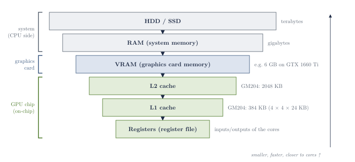

*Figure 1.* Memory hierarchy from disk to registers: each level is smaller and faster, and closer to the cores. Own diagram after [[1](#ref-renderhell), Book I].

**Render state**

- A global definition of how meshes are rendered: "vertex and pixel shader, texture, material, lighting, transparency, etc. […]" ([[1](#ref-renderhell), Book I], quoting his source [b01], p. 711).
- Every mesh drawn uses the current render state until it is changed: a stone, a chair and a sword all get the same material unless the state is changed in between [[1](#ref-renderhell), Book I].

**Draw call**

- A command from the CPU to the GPU to render one mesh. It only points to the mesh (already in VRAM) and carries no material information, which comes from the render state [[1](#ref-renderhell), Book I].

**Pipeline**

- After a draw call, the GPU combines the render state and vertex data and turns them into pixels: building triangles from vertices, lighting, texturing, etc. These steps are the pipeline stages [[1](#ref-renderhell), Book I].
- The book shows a simplified, *logical* pipeline: each triangle/pixel passes through the logical steps, but real hardware works differently; some steps (e.g. triangle and fragment creation) may be done by other parts of the graphics card than the GPU cores [[1](#ref-renderhell), Book I].

**Parallelism**

- Rendering consists of a huge number of small tasks (thousands of vertices, millions of pixels, at least ~30 fps), so they must be computed in parallel [[1](#ref-renderhell), Book I].
- A modern CPU has 4–8 cores, each doing 4–8 float operations at once (~64 floating-point units); a GPU has thousands. The counts are not directly comparable: GPU vendors call the smallest execution unit a "core", CPU vendors the high-level unit [[1](#ref-renderhell), Book I].
- The work of a pipeline stage (e.g. a batch of vertices) is split across many cores [[1](#ref-renderhell), Book I].

**Command buffer**

- The CPU does not wait for the GPU to finish. Commands go into a queue, the *command buffer*: the CPU adds commands and the GPU takes them out when it has free resources, independently of each other [[1](#ref-renderhell), Book I].
- It is FIFO: the GPU always executes the oldest command first [[1](#ref-renderhell), Book I].
- Commands include draw calls and render-state changes [[1](#ref-renderhell), Book I].

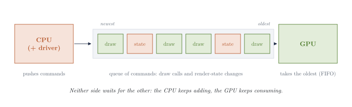

*Figure 2.* The command buffer as a FIFO queue between CPU and GPU. Own diagram after [[1](#ref-renderhell), Book I].

**Relevance to the thesis** (own notes)

- In this model, every mesh costs at least one draw call (plus possible state changes) produced by the CPU, so CPU work grows with the number of objects: this is the CPU-driven baseline.
- Because of the command buffer, the CPU and GPU work asynchronously and can each be the bottleneck: CPU and GPU time must be measured separately.
- A GPU→CPU readback (topic 2) breaks this decoupling: the CPU has to wait for a result the GPU has not produced yet.

**Open questions**

- Where does the driver sit between the API call and the command buffer, and what does it cost? Partly answered in Book II (the driver fills the command buffer and can be a bottleneck); details: Book III, Giesen Part 1 [[3](#ref-giesen)].
- What happens when a mesh has more vertices than there are cores? Answered in Book II: one thread per vertex, bundled into thread blocks and warps that the SMs schedule over time.
- The cache sizes are for GM204 (Maxwell, 2015); look up the numbers for my Turing TU116.

#### 4.1.2 Book II: Pipeline

Source: <https://simonschreibt.de/gat/renderhell-book2/>

- Written with Christoph Kubisch (NVIDIA), so mostly based on NVIDIA architecture (Fermi/Maxwell); many details are omitted or simplified [[1](#ref-renderhell), Book II]. Corrects two points of Book I: not everything is done by the GPU cores, and several pipelines can run in parallel.

**What the cores do (and don't)**

- A core receives commands and data and computes them in a floating-point (FP) or integer (INT) unit: it calculates vertices and pixels (and possibly other things, e.g. physics) [[1](#ref-renderhell), Book II].
- Distributing render tasks, tessellation, culling, preparing fragments for the pixel shader, depth testing and writing pixels to the frame buffer are done by special, non-programmable hardware blocks on the GPU, not by the cores [[1](#ref-renderhell), Book II].

**Parallel pipelines**

- A core needs a *Streaming Multiprocessor (SM)* to assign it work; an SM handles a stream of vertices/pixels belonging to one shader [[1](#ref-renderhell), Book II].
- More cores per SM → more vertices/pixels in parallel, but only of the same shader. More SMs → several shader streams at once, e.g. two pixel shaders, or a vertex and a pixel shader at the same time [[1](#ref-renderhell), Book II].
- The pipeline must be flexible because the workload cannot be predicted, e.g. tessellation can add 100,000 polygons from one frame to the next [[1](#ref-renderhell), Book II].

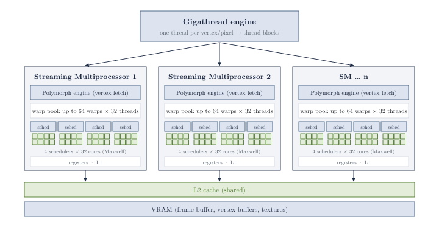

*Figure 3.* Work distribution: the Gigathread engine sends thread blocks to the SMs, which split them into warps. Own diagram after [[1](#ref-renderhell), Book II].

**Pipeline stages** (as presented in the book)

1. *Application:* the game tells the driver it wants something rendered [[1](#ref-renderhell), Book II].
2. *Driver:* puts the commands into the command buffer and, after a while (or when the programmer forces it), sends them to the GPU. "The Driver can be a bottle-neck" (details in Book III) [[1](#ref-renderhell), Book II].
3. *Read commands:* the *Host Interface* on the GPU reads the commands [[1](#ref-renderhell), Book II].
4. *Data fetch:* some commands contain data or copy instructions; a dedicated copy engine moves data RAM ↔ VRAM (vertex buffers, textures, shader parameters; a frame typically starts with camera matrices) [[1](#ref-renderhell), Book II].
   - Rendering works on vertex lists (vertex buffers) and single vertices/pixels, not on whole models.
   - Textures are copied only if not already in VRAM; often-used vertex buffers stay in VRAM; frequently changing vertex buffers may stay in RAM, read by the GPU directly into its caches.
   - The *Gigathread Engine* creates a thread for every vertex/pixel, bundles them into *thread blocks* and distributes them to the SMs.
5. *Vertex fetch:* the SM's *Polymorph Engine* copies the needed data into caches [[1](#ref-renderhell), Book II].
6. *Shader execution:* see below.
7. *Vertex shader:* one instance (thread) per vertex; transforms position, colour, UV, etc. [[1](#ref-renderhell), Book II].
8. *Tessellation (optional):* hull shader, tessellator, domain shader; collapsed section of the page **[To be completed]**.
9. *Primitive assembly:* vertices (from the vertex or domain shader) are gathered into triangles, lines or points; the mode is set by the application per draw call [[1](#ref-renderhell), Book II].
10. *Geometry shader (optional):* works on whole primitives; can modify vertices, create a few new ones and change the primitive type (e.g. point → two triangles). Not suited for mass amplification; used e.g. in voxelisation [[1](#ref-renderhell), Book II].
11. *Viewport transform and clipping:* normalised space is mapped to the window resolution; triangles crossing the *guard band* are clipped, because the rasteriser can only handle triangles within its area [[1](#ref-renderhell), Book II].
12. *Triangle distribution:* there are several rasterisers, each responsible for part of the screen; a triangle is sent to every rasteriser whose area its bounding box overlaps, so big triangles are shared [[1](#ref-renderhell), Book II].
13. *Rasterisation:* backface culling, then edge setup to find which 2×2 pixel *quads* the triangle covers, producing fragments. Working in 2×2 quads can make rendering inefficient (Book III) [[1](#ref-renderhell), Book II].
14. *Z-cull:* "Pixel tiles that lie entirely behind framebuffer pixels are culled from the pipeline, eliminating the need for further pixel shading work" ([[1](#ref-renderhell), Book II], quoting the NVIDIA GF100 whitepaper).
15. *Pixel shader:* one thread per fragment, distributed to the cores like vertices: "we batch up 32 pixel threads, or better say 8 times 2×2 pixel quads, which is the smallest unit we will always work with in pixel shaders" [[1](#ref-renderhell), Book II].
16. *Raster output (ROP):* ROP units move the final pixels from L2 into the frame buffer in VRAM (GF100: 48 ROPs, closely coupled with L2), and handle blending, anti-aliasing coverage and atomic operations [[1](#ref-renderhell), Book II].

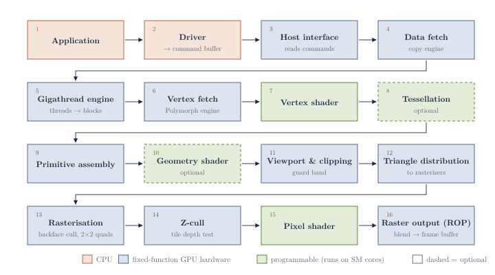

*Figure 4.* The logical pipeline with CPU, fixed-function and programmable stages. Own diagram after [[1](#ref-renderhell), Book II].

**Shader execution: warps, lock-step, latency hiding**

- The SM splits a thread block into groups of 32 threads called *warps*; a Maxwell SM can hold 64 warps and has 4 warp schedulers, each with 32 cores [[1](#ref-renderhell), Book II].
- Cores never see the whole shader, only one instruction at a time; all cores of a warp execute the same instruction on different data (*lock-step*) [[1](#ref-renderhell), Book II].
- On an `if`, both sides are executed one after another, with the inactive cores masked out ("sleeping"); the same for loops. These *divergent threads* should be minimised; if all threads take the same branch, the other side is skipped [[1](#ref-renderhell), Book II].
- The SM holds many more warps than it executes because of *memory stalls*: when a warp waits for data (e.g. a texture read), it is swapped for a warp whose data is ready [[1](#ref-renderhell), Book II].
- Correction by Guohui Wang: with dual issue and instruction-level parallelism, more than 4 warps make progress at once on Maxwell; more than 30 active warps are recommended to keep the pipeline busy [[1](#ref-renderhell), Book II].

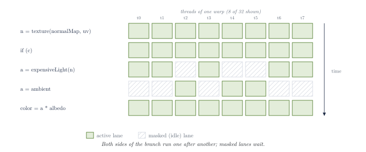

*Figure 5.* Lock-step execution: both sides of a branch are executed one after another, with inactive lanes masked. Own diagram after [[1](#ref-renderhell), Book II].

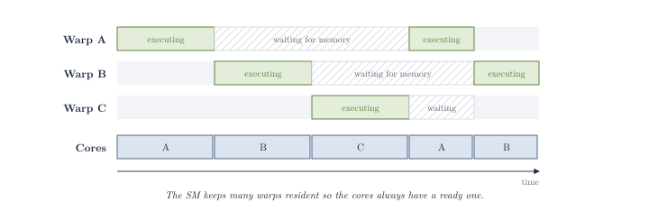

*Figure 6.* Latency hiding: the SM switches to a ready warp while another waits for memory. Own diagram after [[1](#ref-renderhell), Book II].

**Relevance to the thesis** (own notes)

- Culling exists in hardware (backface, guard-band clipping, Z-cull), but only per triangle/pixel tile, after vertex shading. Object-level culling (frustum, occlusion, LOD) has to be done before the draw call: by the CPU in the CPU-driven variant, by a compute shader in the GPU-driven one.
- Z-cull is the hardware analogue of Hi-Z occlusion culling [[8](#ref-greene)], but at pixel-tile level.
- The driver is named as a possible bottleneck (Book III): the CPU cost of a draw call is not only the API call itself.
- Warps, divergence and occupancy matter for the compute shaders in both topics (GPU culling, particle physics); cf. Białas and Strzelecki on the cost of divergence [[15](#ref-bialas)].

**Open questions**

- Tessellation stages (collapsed on the page) still to note.
- How do the NVIDIA terms map to AMD (SM ↔ CU, warp ↔ wavefront of 64) and to Turing (my GPU)?
- What does the driver do exactly when it builds the command buffer, and when does it flush it? Partly answered in Book III (push buffer, chunk-size heuristics, pre-rendered frames).

#### 4.1.3 Book III: Problems

Source: <https://simonschreibt.de/gat/renderhell-book3/>

- Analogy: copying 10,000 files of 1 KB takes much longer than copying one 9.7 MB file, because every copy has a fixed overhead (preparing the transfer, allocating memory, moving HDD heads). Rendering many meshes, i.e. executing many commands, behaves similarly [[1](#ref-renderhell), Book III].
- Worst case: many small meshes, made worse when they use different materials [[1](#ref-renderhell), Book III].

**1. Many draw calls**

- The GPU can often render small meshes faster than the CPU can send the commands. Between the application and the GPU there are the graphics API, the driver and the operating system, and they all add CPU cost [[1](#ref-renderhell), Book III].
- "If you submit few triangles with each call, you will be completely bound by the CPU and the GPU will be mostly idle" ([[1](#ref-renderhell), Book III], quoting his source [f05]).
- "There is driver overhead whenever you make an API call, and the best way to amortize this overhead is to call the API as little as possible" ([[1](#ref-renderhell), Book III], quoting his source [a02]).
- The overhead is much lower on console APIs and the new APIs (DirectX 12, Vulkan, Metal); big submissions are still better than small ones, but less critically than before [[1](#ref-renderhell), Book III].

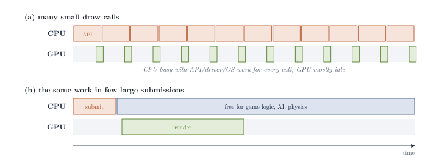

*Figure 7.* CPU-bound rendering with many small draw calls (a) versus few large submissions (b). Own diagram after [[1](#ref-renderhell), Book III].

**2. Many commands**

- CPU and GPU must communicate about changes to the command buffer (by updating read/write pointers), which is also overhead [[1](#ref-renderhell), Book III].
- So the driver collects commands in a *push buffer* and hands them over to the GPU in chunks, not one by one [[1](#ref-renderhell), Book III].
- While the GPU works on the previous chunk, the CPU builds the next one. The driver uses heuristics for chunk size and sometimes queues more than a whole frame before sending ("maximum pre-rendered frames" in the driver settings) [[1](#ref-renderhell), Book III].
- Downside: the GPU renders frames that are "in the past" relative to the latest player input on the CPU, adding latency (bad e.g. for VR) [[1](#ref-renderhell), Book III].
- Modern/console APIs can fill several command buffers in parallel; the driver submits them one after another (serial submission queue). In DirectX 12 these are fast to submit; in DirectX 11 the driver still did extra tracking at submission, reducing the benefit of building them in parallel [[1](#ref-renderhell), Book III].

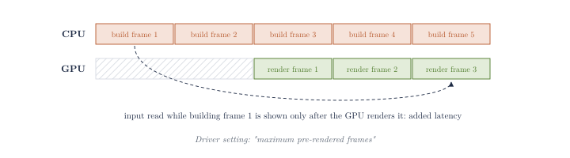

*Figure 8.* Queued frames: the CPU builds frames ahead of the GPU, which adds input latency. Own diagram after [[1](#ref-renderhell), Book III].

**3. Many meshes and materials**

- "When changing the state, there is sometimes a need to wholly or partially flush the pipeline. For this reason, changing shader programs or material parameters can be very expensive […]" ([[1](#ref-renderhell), Book III], quoting his source [b01], pp. 711–712).
- Pattern: set state → draw → set state → draw …; state changes add setup time on both CPU and GPU [[1](#ref-renderhell), Book III].
- A *flush* (not always; depends on the changed parameters and the GPU units) means that all meshes in flight with the old state must finish before meshes with the new state can start, so only a few vertices are processed between changes [[1](#ref-renderhell), Book III].
- Most state-change cost came from older APIs on the CPU side. Because of the fixed minimum setup time per draw call, one can assume that there is no difference between rendering 2 or 200 triangles [[1](#ref-renderhell), Book III].

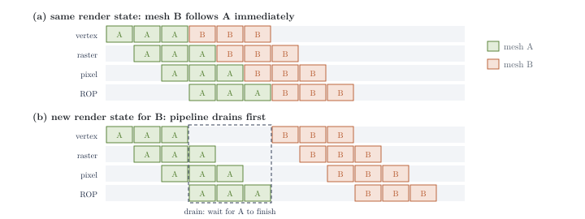

*Figure 9.* A render-state change can force the pipeline to drain before the next mesh starts. Own diagram after [[1](#ref-renderhell), Book III].

**4. Meshes and multi-materials**

- A mesh with several materials is split into pieces, each fed separately into the command buffer: one draw call per piece [[1](#ref-renderhell), Book III].

**5. Single graphics command processor**

- Typical GPUs have a single graphics command processor (front end): even with parallel submission from the CPU, all graphics commands are processed serially there before being distributed to the parallel units [[1](#ref-renderhell), Book III].

**6. Thin triangles**

- Hardware shades 2×2 quads per triangle (on NVIDIA 8 quads = 32 threads per group); fragments of a quad outside the triangle are computed and then ignored [[1](#ref-renderhell), Book III].
- Long thin triangles waste most of the threads in each quad. That is why full-screen post-processing is drawn as one giant triangle extending past the screen, not two triangles with a diagonal [[1](#ref-renderhell), Book III].

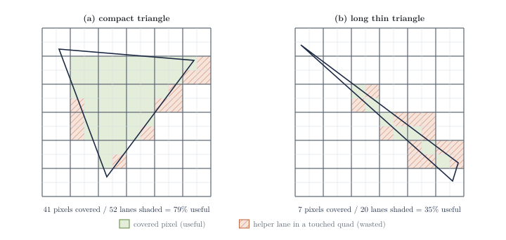

*Figure 10.* Shading in 2×2 quads: share of useful lanes for a compact and a thin triangle (coverage computed at pixel centres). Own diagram after [[1](#ref-renderhell), Book III].

**7. Useless overdraw**

- Much performance is wasted on alpha-blended polygons with large fully transparent areas, e.g. leaf textures or a full-screen quad for a vignette that only darkens the corners. Solution in Book IV [[1](#ref-renderhell), Book III].

**8. Mobile vs PC**

- Mobile GPUs use on-chip memory as an intermediate frame buffer, so blending and anti-aliasing are cheap, but geometry is expensive [[1](#ref-renderhell), Book III].
- They render the frame in *tiles*, copying each finished tile to the frame buffer (more power-efficient); geometry overlapping several tiles is processed several times, so many vertices cost more. Works well for UI and text (blended textured quads) [[1](#ref-renderhell), Book III].
- Desktop/console GPUs are roughly the opposite [[1](#ref-renderhell), Book III].

**From the comments** (not authoritative)

- Simon: the number of draw calls alone is not a reliable indicator; bottlenecks must be measured per project [[1](#ref-renderhell), Book III].
- Reader "a lemon": draw-call overhead is mostly CPU work in the driver (guessing whether more data is coming, optimising the command buffer, removing redundant state changes). Indirect draws pack many draws (without state changes) into one buffer and can even be generated on the GPU; in his test, one draw with many instances was still 2–4× faster than many indirect draws with one instance each. Mentions NVIDIA's Vulkan device-generated commands extension (indirect draws with state changes) [[1](#ref-renderhell), Book III].

**Relevance to the thesis** (own notes)

- This is the core motivation of topic 1: in the CPU-driven variant, CPU time per frame grows with the number of draw calls and state changes, while the GPU may be idle.
- The draw-call overhead lives in the API, driver and OS layers, so with OpenGL 4.6 (an "old" API in this sense) it should be large; this supports measuring the driver's share of CPU time.
- "2 or 200 triangles cost the same" suggests that the threshold N\* depends more on the number of objects than on their triangle counts; worth testing by varying both.
- Push buffers and pre-rendered frames show that the CPU runs ahead of the GPU by up to several frames, which matters for topic 2: a readback either waits for the GPU (stall) or arrives with a latency of a few frames.
- The single command processor means that multi-draw indirect, not parallel submission, is the way to cut the command count; the reader's test suggests that instancing can beat many indirect draws, so variant (b) vs (c) and instancing should be compared.

**Open questions**

- How large is the per-draw-call CPU cost in OpenGL 4.6 on my machine, and what share of it is the driver (measure with Nsight Systems)?
- Which state changes cause a pipeline flush on current NVIDIA hardware, and which are cheap?
- Is the "2 vs 200 triangles" rule still true on Turing, and where does it stop?
- How do pre-rendered frames interact with GPU→CPU readback latency?

#### 4.1.4 Book IV: Solutions

Source: <https://simonschreibt.de/gat/renderhell-book4/>

- Solutions to the problems of Book III, from the point of view of how assets should be prepared to render well [[1](#ref-renderhell), Book IV].

**1. Sorting**

- Sort the commands (e.g. by render state) before filling the command buffer, so that all meshes of one kind are drawn before the state changes: state changes drop to the minimum [[1](#ref-renderhell), Book IV].
- The overhead of one draw call per mesh remains; batching addresses that [[1](#ref-renderhell), Book IV].

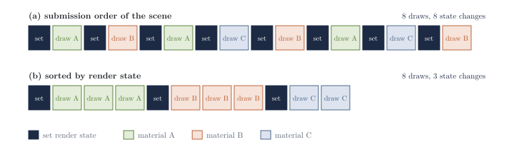

*Figure 11.* Sorting the same eight draws by render state reduces the state changes from eight to three. Own diagram after [[1](#ref-renderhell), Book IV].

**2. Batching**

- "'Batching' means to group some meshes together before calling the API to draw them. This is why it takes less time to render a big mesh than multiple small meshes" ([[1](#ref-renderhell), Book IV], quoting his source [a36]).
- Meshes sharing a render state (the same material setup) are combined and drawn with one draw call; they can be different meshes, e.g. a stone, a chair and a sword [[1](#ref-renderhell), Book IV].
- The combined mesh is built in RAM and then uploaded to VRAM, which takes time. So batching suits static objects (stones, houses), combined once and kept in memory [[1](#ref-renderhell), Book IV].
- Dynamic objects (e.g. laser bullets) can be batched too, but the combined mesh must be rebuilt and uploaded every frame [[1](#ref-renderhell), Book IV].
- Culling problem (credited to koyima): a separate object outside the camera frustum can be skipped, but a batched mesh must be drawn as a whole even if only a small part is visible, which can reduce performance [[1](#ref-renderhell), Book IV].

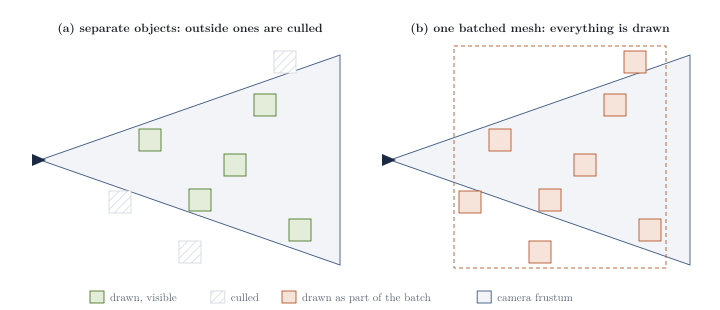

*Figure 12.* Separate objects can be culled one by one (a); a batched mesh is drawn as a whole even when most of it is outside the frustum (b). Own diagram after [[1](#ref-renderhell), Book IV].

**3. Instancing**

- Only one mesh is sent (e.g. one laser bullet) and the GPU duplicates it; a stream of extra per-instance data (e.g. a transformation matrix) places each copy at a different position and pose [[1](#ref-renderhell), Book IV].
- "Typical attributes per instance are the model-to-world transformation matrix, the instance color, and an animation player providing the bones used to skin the geometry packet" ([[1](#ref-renderhell), Book IV], quoting his source [a37]).
- Simon's understanding (unsure, by his own words): the per-instance data is a list in RAM that the GPU can access [[1](#ref-renderhell), Book IV]. **[To verify]**: in modern APIs it is usually a buffer in VRAM.
- Result: one draw call per mesh type. Difference from batching: instances are copies of the same mesh, while a batch can contain different meshes that share a render state [[1](#ref-renderhell), Book IV].

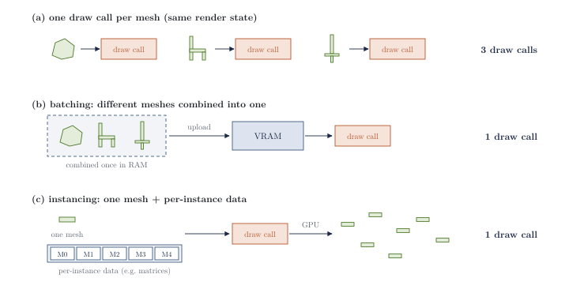

*Figure 13.* One draw call per mesh (a), batching different meshes with the same render state (b), and instancing one mesh with per-instance data (c). Own diagram after [[1](#ref-renderhell), Book IV].

**4. Multi-material shader**

- A shader can sample several texture sets (e.g. two diffuse/normal/specular sets) and blend them with a blend texture, so a mesh with two materials is no longer split into one draw call per material (Book III, problem 4) [[1](#ref-renderhell), Book IV].
- The blending costs GPU time; according to the engine documentation Simon cites, a higher draw-call count is still better than this expensive technique. It reduces the draw-call count, but that says nothing about performance [[1](#ref-renderhell), Book IV].

**5. Skinned meshes**

- For many moving objects (the laser bullets): give every bullet its own bone and skinning weights, keep one big mesh in memory and update only the bone data each frame. The mesh must be rebuilt only when bullets are created or destroyed [[1](#ref-renderhell), Book IV].

**6. Reducing overdraw**

- Vignette example (Alex / Axiomworks): instead of a full-screen quad with a mostly transparent texture, use a quad mesh that is hollow in the transparent middle, with vertex colours instead of a texture. This gives better quality (no compression artefacts) and less overdraw, since only the opaque border is drawn [[1](#ref-renderhell), Book IV].

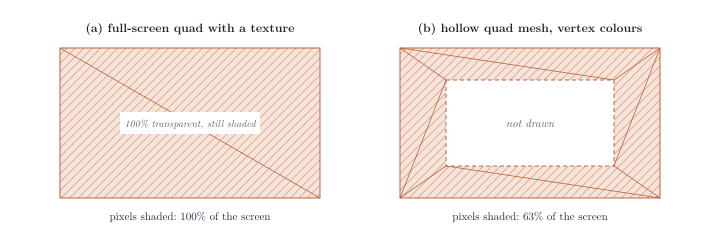

*Figure 14.* A full-screen quad shades every pixel even where it is fully transparent (a); a hollow mesh shades only the border (b). The percentage is for this drawing. Own diagram after [[1](#ref-renderhell), Book IV].

**7. And a lot more magic**

- APIs and hardware keep evolving; efficient engines need sophisticated engineering. Good sources: the SIGGRAPH Advances in Real-Time Rendering course, Unreal Engine documentation and source, Frostbite presentations, and hardware vendors' documentation and samples [[1](#ref-renderhell), Book IV].
- Rendering middleware already does much of the heavy lifting, so artists mainly need to know which optimisations they have to care about themselves [[1](#ref-renderhell), Book IV].

**From the comments** (not authoritative)

- Reader "a": meshes can also be combined on the GPU, without copying, by computing a new index buffer in a compute shader and issuing an indirect draw call [[1](#ref-renderhell), Book IV].

**Relevance to the thesis** (own notes)

- Sorting, batching and instancing are the classic CPU-side ways to reduce draw calls and state changes; they define what the "naive CPU" and the "CPU with multi-draw indirect" variants of topic 1 should and should not do.
- The batching/culling trade-off is exactly what GPU-driven rendering removes: culling stays per object (in a compute shader), yet the surviving objects are still drawn with one indirect call. The reader comment describes this approach [[5](#ref-haar)], [[7](#ref-wihlidal)].
- Batching dynamic objects means re-uploading every frame (CPU → GPU traffic); instancing and skinning only update small per-instance or per-bone buffers. This is the same trade-off as in topic 2: keep data on the GPU and send as little as possible.
- Instancing covers only identical meshes; scenes with many different meshes need multi-draw indirect (one call, many different meshes), which is a reason to compare both in the experiments.
- Simon's claim that the instance data lives in RAM should be checked against OpenGL 4.6 (instanced vertex attributes, SSBOs).

**Open questions**

- How does multi-draw indirect relate to batching and instancing: is it "batching without merging meshes"? (Probably covered in [[5](#ref-haar)], [[6](#ref-everitt)].)
- Where should the per-instance data live in OpenGL 4.6 (vertex attribute divisor vs SSBO), and what does updating it cost per frame?
- Does sorting by render state still matter with bindless textures and a single shader (as in GPU-driven pipelines)?

#### 4.1.5 Book V: Conclusion

Source: <https://simonschreibt.de/gat/renderhell-book5/>

- A short summary of the series, addressed to artists [[1](#ref-renderhell), Book V].

**Recommendations**

- *Avoid small meshes.* Combine several small meshes into one where possible. Ask a graphics programmer for the polycount "sweet spot": meshes below that triangle count are not rendered any faster, so a small mesh may as well get a few more triangles (e.g. to look rounder) [[1](#ref-renderhell), Book V].
- *Watch multi-materials.* One big mesh with 5 sub-materials is split during rendering into 5 small meshes again; an atlas texture may help [[1](#ref-renderhell), Book V].
- *Avoid too many materials.* Plan material sharing between assets before creating them; bigger atlas textures can help [[1](#ref-renderhell), Book V].
- *Debug tools.* In-game statistics can warn that an asset may be a performance problem before it is committed as final [[1](#ref-renderhell), Book V].
- *Ask the coder.* The topic is highly technical and context-dependent (hardware, engine, driver, game perspective) [[1](#ref-renderhell), Book V].

**From the comments** (Simon's answers; not authoritative)

- Texture-atlas trade-offs: an atlas only pays off if its assets are always used together; otherwise the whole atlas must be loaded for one asset. Further costs: an alpha channel for the whole atlas even if one asset needs it, colour bleeding between sub-textures at lower mip levels (so UVs need padding from the borders), and no UV animation (scrolling would move the whole atlas) [[1](#ref-renderhell), Book V].
- Whether combining is automatic depends on the engine, e.g. Unity batches static objects with the same material; Unreal can merge meshes and their materials into an atlas ("Merge Actors") [[1](#ref-renderhell), Book V].
- One shader with two texture sets is probably cheaper than layered material blending, but "Performance is nothing you can calculate but only test" (Simon, citing "a wise dude") [[1](#ref-renderhell), Book V].

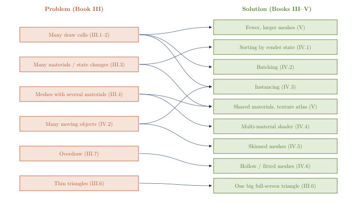

*Figure 15.* Render Hell in one picture: the problems of Book III and the solutions of Books III–V that address them. Own diagram after [[1](#ref-renderhell), Books III–V].

**Relevance to the thesis** (own notes)

- The "sweet spot" is the per-object version of the threshold N\* from the seminar hypotheses (topic 1): below some size, work per object is dominated by fixed overhead. In the experiments, vary both the object count and the triangles per object.
- All Render Hell solutions are CPU-side or content-side (fewer, bigger, sorted submissions). None moves culling or draw-call generation to the GPU; that is where Part II of the reading starts [[5](#ref-haar)]–[[9](#ref-karis)].
- "Only test, don't calculate" supports the thesis approach: hypotheses checked by measurement, not by estimation.

**Open questions**

- Where is the triangle "sweet spot" on my GTX 1660 Ti with OpenGL 4.6, and does it move between the CPU-driven and GPU-driven variants?
- Do bindless textures or texture arrays remove the need for atlases in a GPU-driven renderer (no bleeding, no shared alpha)?

**Render Hell overall** (own summary)

- Books I–II: how data and commands travel from CPU to GPU, and how the GPU executes them in parallel.
- Book III: why many small draw calls and state changes make the CPU the bottleneck.
- Books IV–V: how to submit less, but bigger and better-sorted work.
- Level: intuitive, artist-oriented, 2015 hardware (Fermi/Maxwell) and pre-DX12 APIs. Next: Life of a triangle [[2](#ref-kubisch)] and Giesen [[3](#ref-giesen)] for detail.

### 4.2 Life of a Triangle: NVIDIA's Logical Pipeline [[2](#ref-kubisch)]

Source: <https://developer.nvidia.com/content/life-triangle-nvidias-logical-pipeline> (Christoph Kubisch, 2015). Sections cited by heading.

- A primer on the graphics architecture introduced with Fermi and kept in Kepler and Maxwell, compiled from public whitepapers and GTC talks. Graphics viewpoint, but shader execution works the same way for compute [[2](#ref-kubisch), "Introduction"].
- Written by the NVIDIA engineer who helped with Render Hell Book II, so it is the more precise version of that book.

**GPUs are super parallel work distributors**

- Graphics has *data amplification* with highly variable workloads: each draw call may produce a different number of triangles, clipping changes the vertex count, culling removes triangles, and a triangle may cover millions of pixels or none [[2](#ref-kubisch), "GPUs are super parallel work distributors"].
- So primitives follow a *logical* pipeline, not a physical one. Before G80 (DX9, PS3, Xbox 360) the stages existed on the chip and work flowed through them in order; G80 shared units between vertex and pixel shading but kept a serial primitive/raster part; since Fermi the pipeline is fully parallel, implementing the logical steps by reusing many engines [[2](#ref-kubisch), "GPUs are super parallel work distributors"].
- Two triangles can be at different steps at the same time: parts of A are rasterised, shaded, Z-culled or written, while B's vertices are being fetched. The job is split into many small tasks scheduled on whatever resources are free (vertex and pixel shading in parallel) [[2](#ref-kubisch), "GPUs are super parallel work distributors"].
- "Think of a river that fans out": independent parallel streams, each on its own timeline [[2](#ref-kubisch), "GPUs are super parallel work distributors"].

**GPU architecture**

- The *Giga Thread Engine* manages all work. The GPU is split into several *GPCs* (Graphics Processing Clusters), each with several SMs and one *Raster Engine*. A *crossbar* lets work move between GPCs and to other units such as the ROP subsystems [[2](#ref-kubisch), "GPU architecture"].
- Shader programs run on the SMs. An SM has many cores doing the maths for threads (one thread = e.g. one vertex- or pixel-shader invocation), driven by *warp schedulers* that manage groups of 32 threads (warps) and pass instructions to *dispatch units* [[2](#ref-kubisch), "GPU architecture"].
- A core is "rather dumb" compared to a CPU core: it only sees something like "sum register 4234 with register 4235 and store in 4230". The control logic lives in the scheduler, i.e. at a higher level [[2](#ref-kubisch), "GPU architecture"].
- The counts depend on the chip: GM204 has 4 GPCs × 4 SMs, Tegra X1 has 1 GPC × 2 SMs (both Maxwell). The SM design itself changes between generations [[2](#ref-kubisch), "GPU architecture"].

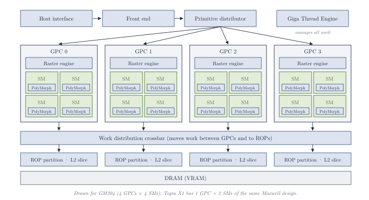

*Figure 16.* GPU hierarchy since Fermi, drawn for GM204: front end, GPCs with a raster engine and SMs, crossbar, ROP partitions and DRAM. Own diagram after [[2](#ref-kubisch)].

**The logical pipeline** (one draw call, index and vertex buffers already in GPU memory, vertex and pixel shader only) [[2](#ref-kubisch), "The logical pipeline"]

1. The application makes a draw call in the API. The driver validates it ("legal"?) and writes the command, in a GPU-readable encoding, into a *pushbuffer*. "A lot of bottlenecks can happen here on the CPU side of things."
2. After a while or an explicit flush, the driver sends the pushbuffer to the GPU (with some OS involvement). The *Host Interface* picks up the commands, which are processed by the *Front End*.
3. The *Primitive Distributor* processes the index buffer and sends batches of triangles to several GPCs.
4. In a GPC, the *PolyMorph Engine* of one SM fetches the vertex data (vertex fetch).
5. Warps of 32 threads are scheduled on the SM to work on the vertices.
6. The warp scheduler issues instructions in order for the whole warp; threads run in lock-step and can be masked out (branches, loops). "Threads cannot advance individually, only as a warp! Warps, however, are independent of each other."
7. An instruction may take several dispatch turns, e.g. the SM has fewer load/store units than math units.
8. When a warp waits (especially for memory), the scheduler switches to another warp. Every thread has its own registers in the register file, which makes switching fast: "The more registers a shader program needs, the less threads/warps have space", and the less latency can be hidden.
9. The vertex-shader results go through the *viewport transform*; the triangle is clipped against the clip-space volume. L1 and L2 caches hold the data passed between tasks.
10. The triangle's bounding box decides which raster engines (each covering screen tiles) must work on it; it is sent to one or more GPCs through the *work distribution crossbar*.
11. *Attribute setup* on the target SM puts the interpolants (vertex-shader outputs) into a pixel-shader-friendly format.
12. The GPC's *Raster Engine* generates pixel information for its screen tiles, including back-face culling and Z-cull.
13. Pixel threads are batched as 32 threads = 8 × 2×2 quads, the smallest pixel-shader unit. The quad gives derivatives for texture mip-map selection; threads in the quad that do not cover the triangle are masked out (`gl_HelperInvocation`).
14. Pixel shading runs like vertex shading; lock-step makes values of the other pixels in a quad available almost for free (`NV_shader_thread_group`).
15. Before the ROPs, the original API order of triangles is restored. The *ROP* units do depth testing and blending atomically (so colour and depth of one pixel come from the same triangle). NVIDIA uses memory compression to raise effective bandwidth.

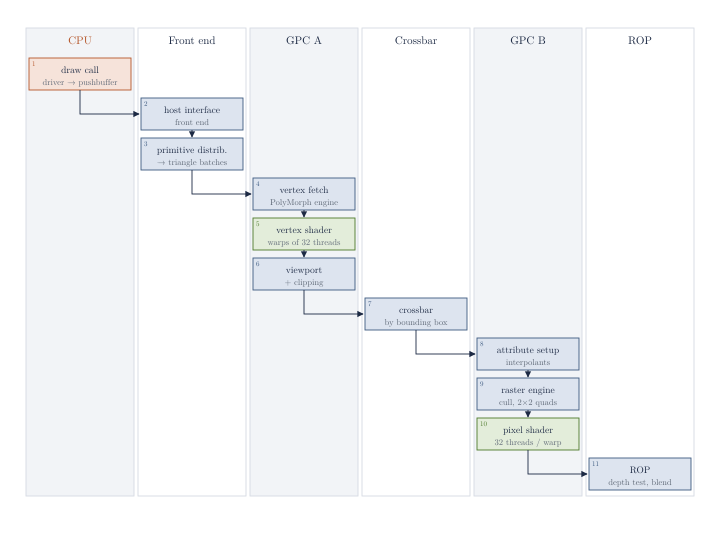

*Figure 17.* The path of one triangle through the units of the GPU; the numbers are a condensed version of the steps above. Own diagram after [[2](#ref-kubisch)].

**Synchronisation with the CPU**

- The pipeline explains why CPU–GPU synchronisation is "really hurtful": the CPU has to wait until everything is finished and no new work is submitted, so all units become idle, and after new work is sent "it takes a while until everything is fully under load again, especially on the big GPUs" [[2](#ref-kubisch), "The logical pipeline"].
- Rendering a CAD model coloured by SM or warp id shows that work distribution is not frame-coherent: it changes from frame to frame, and several draw calls may be processed in parallel (visible in Nsight) [[2](#ref-kubisch), "The logical pipeline"].

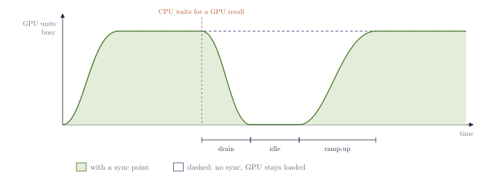

*Figure 18.* GPU utilisation around a sync point: drain, idle while the CPU waits and builds new work, then ramp-up (illustrative). Own diagram after [[2](#ref-kubisch)].

**Further reading** (listed in the article): Giesen's "A trip through the graphics pipeline" [[3](#ref-giesen)]; Micikevicius, "Performance Optimization Guidelines and the GPU Architecture behind them"; Eldridge et al., "Pomegranate: A Fully Scalable Graphics Architecture" (parallel stages and work distribution).

**Relevance to the thesis** (own notes)

- Step 1 states where the CPU cost of a draw call lives: driver validation and encoding into the pushbuffer. This is the cost the GPU-driven variant should remove (topic 1).
- The sync-point argument is central to topic 2: a synchronous readback not only waits for the result, it also empties the whole GPU, and the ramp-up afterwards is lost throughput. Asynchronous readback with 1–3 frames of latency avoids exactly this.
- Register pressure limits the number of resident warps and therefore latency hiding; relevant for the culling and physics compute shaders (check register counts and occupancy in Nsight).
- Work distribution varies frame to frame, so timings will be noisy: supports reporting the median and 99th percentile over many frames.
- The crossbar step shows that one triangle can be handled by several GPCs; large triangles are spread out, while tiny triangles (e.g. distant objects without LOD) still pay the per-triangle setup cost.

**Open questions**

- What is the configuration of my TU116 (GPCs, SMs per GPC, register file per SM)? **[To verify]** in the Turing whitepaper.
- How large is the drain + ramp-up cost of a full sync (e.g. `glFinish` or a blocking `glGetBufferSubData`) on my GPU? A small experiment for topic 2.
- How does the pushbuffer relate to the OpenGL command stream and to `glFlush`?

### 4.3 A Trip through the Graphics Pipeline 2011 (Fabian Giesen) [[3](#ref-giesen)]

Source: <https://fgiesen.wordpress.com/2011/07/09/a-trip-through-the-graphics-pipeline-2011-index/>. Parts cited by number, e.g. [[3](#ref-giesen), Part 1].

#### 4.3.1 Index: Aim and Scope

- The D3D/OpenGL pipeline "as actually implemented by GPUs". Fills the gap between broad overviews and very detailed descriptions of single components, most of which are out of date [[3](#ref-giesen), Index].
- Audience: graphics programmers who know a modern 3D API (at least OpenGL 2.0+ or D3D9+) and want to see what is under the hood; assumes knowledge of registers, FIFOs, caches, pipelines and basic parallel programming: "A GPU is a massively parallel computer, there's no way around it" [[3](#ref-giesen), Index].
- Level: "GPU architects would call this a high-level description of a GPU", but far denser than the colourful flowcharts of hardware review sites; lots of text, a few single-colour diagrams and some equations [[3](#ref-giesen), Index].
- Scope (from his comment): the basic D3D11 pipeline; leaves out advanced anti-aliasing, point and line primitives, cube-map filtering details and vendor filtering "optimisations" [[3](#ref-giesen), Index].
- Licence: CC0 (copyright waived), so his text and diagrams may be reused freely, unlike Render Hell.
- Written in 2011 while Giesen was working on a GPU (his comment), so it reflects D3D11-era hardware, between Render Hell's Fermi/Maxwell and the newer mesh-shader generation (not covered) [[3](#ref-giesen), Index].

**From the comments**

- Constant buffers: originally a special register file on the chip; since D3D10 the limits (up to 16 CBs per stage, 64 KB each, up to 1 MB per stage) are too large for that, so CBs are ordinary buffers in memory like vertex buffers, index buffers and textures. With the new general cache between shader units and memory, Giesen would simply leave them memory-mapped and let the cache handle them [[3](#ref-giesen), Index].

#### 4.3.2 Reading Plan

**Table 1.** Parts of the series and their relevance to the thesis.

| Part | Topic | Read | Relevance |
|---|---|---|---|
| 1 | Introduction; the software stack | ✅ | driver overhead, command buffers (topic 1) |
| 2 | GPU memory architecture and the command processor | ✅ | command processor, CPU–GPU sync (topics 1, 2) |
| 3 | 3D pipeline overview, vertex processing | ⬜ | vertex fetch, vertex shading |
| 4 | Texture samplers | ⬜ | background |
| 5 | Primitive assembly, clip/cull, projection, viewport transform | ⬜ | hardware culling vs object culling |
| 6 | (Triangle) rasterisation and setup | ⬜ | small/thin triangles |
| 7 | Z/stencil processing, 3 different ways | ⬜ | early-Z, Hi-Z (topic 1, occlusion culling) |
| 8 | Pixel processing: "fork phase" | ⬜ | pixel shading, quads |
| 9 | Pixel processing: "join phase" | ⬜ | ROP, blending, ordering |
| 10 | Geometry shaders | ⬜ | background |
| 11 | Stream-out | ⬜ | GPU-side data feedback |
| 12 | Tessellation | ⬜ | background (missing from my Render Hell notes) |
| 13 | Compute shaders | ⬜ | GPU culling, draw generation, physics (topics 1, 2) |

- Priority for the thesis: Parts 1, 2, 13, then 7 and 5. **[To be completed]** notes per part as they are read.

#### 4.3.3 Part Notes

##### Part 1: Introduction; the Software Stack

Source: <https://fgiesen.wordpress.com/2011/07/01/a-trip-through-the-graphics-pipeline-2011-part-1/>

- Scope: DX11-class hardware with D3D9/10/11 on Windows, the stack Giesen knows best; past this part the API hardly matters, since the GPU only sees native commands [[3](#ref-giesen), Part 1].

**The layers between a draw call and the GPU**

- *Application:* your code, and your bugs [[3](#ref-giesen), Part 1].
- *API runtime:* tracks the current state, validates parameters, checks errors and consistency, manages user-visible resources (textures, buffers, render targets), validates shader code and linkage (in D3D; in OpenGL the driver does this), may batch work, then hands everything to the user-mode driver [[3](#ref-giesen), Part 1].
- *User-mode driver (UMD)* (e.g. `nvd3dum.dll`): "where most of the 'magic' on the CPU side happens". A regular DLL in the application's address space, without privileges; implements a lower-level interface (the DDI) that is more explicit about memory management [[3](#ref-giesen), Part 1]:
  - *Shader compilation:* D3D passes pre-validated, pre-optimised bytecode; the UMD turns it into an intermediate representation and compiles it for the hardware (register allocation, scheduling, hardware limits). Well-known games may get hand-optimised replacement shaders, detected and swapped in by the UMD.
  - Some API state is compiled into the shader (e.g. texture borders emulated in shader code), so one shader can exist in several versions for different state combinations.
  - Creation and compilation are often deferred until first use, which causes a hitch the first time a shader or resource is used; programmers issue dummy draw calls to "warm it up".
  - Translates legacy D3D9 shader versions and the fixed-function pipeline into modern shaders.
  - *Memory management:* sub-allocates large blocks obtained from the KMD; can swizzle textures and schedule transfers between system and video memory.
  - Most importantly, writes *command buffers* (also called *DMA buffers*): state changes and draws, plus implicit work such as uploading textures and shaders, become hardware commands.
- Drivers keep as much work as possible in the UMD: no kernel transitions, free memory allocation, multithreading; a crash takes down only the application, and the UMD is easy to replace and debug [[3](#ref-giesen), Part 1].
- *Graphics scheduler* (OS component): the GPU is shared by many processes (including the window system), so the scheduler time-slices the 3D pipeline between them. A context switch costs at least some GPU state switching (extra commands) and possibly swapping resources in and out of video memory; only one process submits to the 3D pipe at a time [[3](#ref-giesen), Part 1].
- Why PC APIs are "high-level" and slower than console APIs: the driver must track the full state at all times because another process may take over the GPU at any moment, and it also works around broken applications and fixes performance problems behind their backs [[3](#ref-giesen), Part 1].
- *Kernel-mode driver (KMD):* only one per system; if it crashes, the system is affected (Windows can now reload it). Handles everything that exists once: allocating and mapping physical memory, GPU initialisation, display modes, the hardware cursor, the watchdog timer that resets a hung GPU, interrupts, content protection [[3](#ref-giesen), Part 1].
- The KMD manages the command buffer the hardware actually consumes. UMD command buffers are only slices of GPU-addressable memory: the UMD finishes them and submits them to the scheduler, which waits until that process's turn and passes them to the KMD; the KMD writes a *call* to the buffer into the *main command buffer* (and may DMA it to video memory first) [[3](#ref-giesen), Part 1].
- The main command buffer is a small *ring buffer* containing only system/initialisation commands and calls to the real 3D command buffers. A *read pointer* (where the GPU is) and a *write pointer* (how far the KMD has written) are memory-mapped hardware registers; the KMD updates the write pointer when it submits new work [[3](#ref-giesen), Part 1].
- *Bus:* the pointer writes and DMA transfers go over PCI Express (unless the GPU is integrated on the CPU die) [[3](#ref-giesen), Part 1].
- *Command processor:* the GPU front end that reads the commands; continued in Part 2 [[3](#ref-giesen), Part 1].

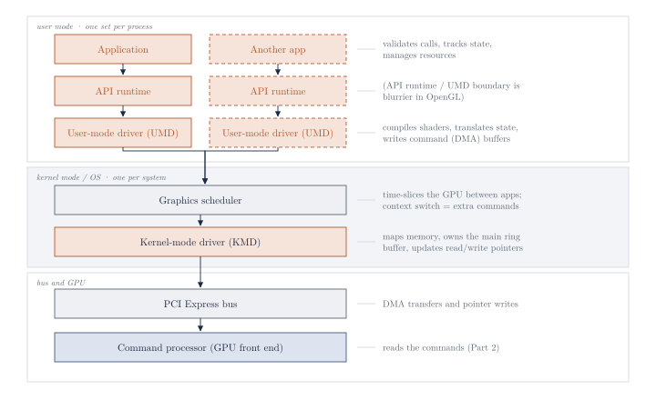

*Figure 19.* The software stack from the application to the GPU command processor: per-process user-mode layers, one scheduler and KMD per system. Own diagram after [[3](#ref-giesen), Part 1].

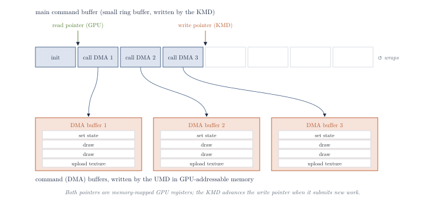

*Figure 20.* The main ring buffer written by the KMD holds calls to the DMA buffers written by the UMD; the GPU read pointer chases the KMD write pointer. Own diagram after [[3](#ref-giesen), Part 1].

**OpenGL aside**

- In OpenGL the API runtime and the UMD are less clearly separated, and GLSL is compiled entirely by the driver. So every vendor has its own GLSL front end with its own bugs and quirks, and the driver must do all optimisations, including expensive ones, at run time. D3D bytecode (one compiler, offline optimisation) is "really a cleaner solution" [[3](#ref-giesen), Part 1].
- Omitted for now: multiple scheduler implementations and CPU–GPU synchronisation (later parts) [[3](#ref-giesen), Part 1].

**From the comments** (Giesen's replies)

- Full sequence: App → API (OS/driver) → UMD (driver) → scheduler (OS) → KMD (driver) → GPU. The command/DMA buffer is part of the Windows driver model, since the scheduler passes it around without reading it [[3](#ref-giesen), Part 1].
- Command buffers live in write-combined (uncached, store-buffered) memory, so submission needs only a store fence, which is cheap compared to the scheduler and the user→kernel transition [[3](#ref-giesen), Part 1].
- "Graphics drivers are up to 3 frames ahead of the GPU" (capped at 3 because more hurt input latency): at 60 Hz the latency from a draw call to GPU processing is about 50 ms. The stack adds this latency on purpose, to keep the GPU fed at all times [[3](#ref-giesen), Part 1].
- On Linux, the kernel DRM driver plays the role of the KMD and the GL driver/libdrm of the UMD; there is no central graphics scheduler or video memory manager as on Windows [[3](#ref-giesen), Part 1].
- Mantle, D3D12 and Vulkan do not give direct access to the hardware command buffers; they remove intermediate software layers by moving work to the application. They replace the "state machine" model of OpenGL and older D3D with state compiled in advance into a hardware-friendly format, and move resource residency, memory and dependency tracking largely to the application. "That's where the speed-ups come from. The underlying HW didn't change at all" [[3](#ref-giesen), Part 1].
- Async compute: the GPU can process several command streams at once (several command processors, or time-slicing one) [[3](#ref-giesen), Part 1].

**Relevance to the thesis** (own notes)

- This is the detailed answer to "where does the CPU cost of a draw call go": API runtime validation and state tracking, UMD state translation, shader-variant compilation and command encoding, then the scheduler and kernel transition at submission. With OpenGL 4.6 all of this applies per draw call and per state change, which is the overhead the GPU-driven variant removes (topic 1).
- Deferred creation and shader compilation on first use cause hitches; the experiments need warm-up frames before measuring.
- OpenGL compiles GLSL in the driver, and state can produce shader variants: keep the state set small and constant across the compared variants so that they differ only in the submission method.
- "Up to 3 frames ahead" quantifies the CPU–GPU gap from Render Hell Book III. For topic 2, a result read back without stalling is inherently a few frames old; a synchronous readback drains this whole queue.
- Giesen's D3D12/Vulkan comment explains why modern APIs are faster without new hardware. Since the thesis stays with OpenGL 4.6, the GPU-driven approach (multi-draw indirect, compute-generated commands) is the way to get similar savings inside an "old" API.

**Open questions**

- How much of the OpenGL draw-call cost is runtime/UMD work vs submission (kernel transition)? Nsight Systems shows driver threads; check whether the NVIDIA OpenGL driver uses a separate worker thread (threaded optimisation).
- How many frames ahead does the NVIDIA OpenGL driver run by default, and how does it interact with fences and `glClientWaitSync`?

##### Supplementary to Part 1: Texture Tiling and Swizzling [[19](#ref-giesen-swizzle)]

Source: <https://fgiesen.wordpress.com/2011/01/17/texture-tiling-and-swizzling/> (background for "the UMD can swizzle textures" in Part 1).

- A linear (row-major) image, index `y * stride + x`, is cache-friendly only when walking along rows; moving down a column puts every pixel in a different cache line. So GPUs prefer *tiled* or *swizzled* layouts; the exact patterns depend on the memory subsystem, the principles are the same everywhere [[19](#ref-giesen-swizzle)].
- *Tiling:* the image is split into M × N tiles (powers of 2), e.g. 4×4 pixels of 32 bpp = one 64-byte cache line, so any traversal that does not jump wildly gets similar hit rates; images are padded to multiples of the tile size [[19](#ref-giesen-swizzle)].
- *Swizzling:* form the linear address, then permute its bits. *Morton order* (Z-order) interleaves the x and y bits (`… y1 x1 y0 x0 c1 c0`); it is nearly free in hardware (only wiring). 4×4 tiling is itself a bit permutation, and patterns can be "completely wild" (e.g. 8×8 Morton tiles with one colour channel per tile) [[19](#ref-giesen-swizzle)].
- *Nested tiling:* tiles inside tiles; Morton order is the extreme case (2×2 in 4×4 in 8×8 …). Non-square power-of-2 textures use H × H Morton tiles in a row; non-power-of-2 sizes use row-major order above a top-level tile size (padding only to that size) [[19](#ref-giesen-swizzle)].
- Software swizzling (e.g. converting decoded JPEG/PNG data at run time, with partial sub-rectangle updates): iterate in destination order in the innermost loop and write whole aligned cache lines, because the destination is usually *write-combined* (uncached) memory where non-sequential writes are expensive [[19](#ref-giesen-swizzle)].
- Incrementing a swizzled coordinate without decoding it: split the offset into an x part and a y part (summed, constant per row) and step with `offs_x = (offs_x - x_mask) & x_mask`. Setting the "holes" between x bits to 1 lets the carry ripple through them; only the two masks depend on the swizzle pattern [[19](#ref-giesen-swizzle)].
- The idea applies to any 2D data traversed in both directions, e.g. blocked/Morton-ordered matrices in linear algebra. Code snippets are public domain; the posts are CC BY-SA 3.0 (unlike the CC0 pipeline series) [[19](#ref-giesen-swizzle)].

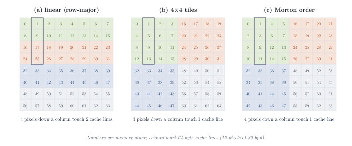

*Figure 21.* Memory order of an 8×8 image in linear, 4×4-tiled and Morton layout; with 64-byte cache lines, walking down a column touches fewer lines in the tiled layouts. Own diagram after [[19](#ref-giesen-swizzle)].

##### Supplementary to Part 1: Ring Buffers and Queues [[20](#ref-giesen-ring)]

Source: <https://fgiesen.wordpress.com/2010/12/14/ring-buffers-and-queues/> (background for the main command buffer in Part 1).

- A ring buffer is a bounded FIFO: an element array plus `ReadPos` and `WritePos`. It is everywhere in IO and hardware communication and between threads; with hardware, the case is single producer, single consumer (SPSC), and the positions are usually memory-mapped registers. The producer waits when the queue is full, the consumer when it is empty; the goal is a steady state where neither waits [[20](#ref-giesen-ring)].
- *Model 1, array indices:* write `Elem[WritePos]`, then `WritePos = (WritePos + 1) % SIZE`. Empty if `ReadPos == WritePos`, but a full queue looks the same, so block at `SIZE − 1` elements rather than adding special cases (which make lock-free and hardware use hard). The usual model in hardware [[20](#ref-giesen-ring)].
- *Model 2, virtual stream:* positions count the total distance travelled; index with `Pos % SIZE`. With a power-of-2 `SIZE` the wrap is cheap, the count is always `WritePos − ReadPos`, a full queue is `WritePos == ReadPos + SIZE`, and even integer overflow is handled correctly by unsigned arithmetic [[20](#ref-giesen-ring)].
- Virtual streams make invariants easy to state and check (`WritePos − ReadPos <= SIZE`). Example: audio hardware keeps reading whether the producer is ready or not; a running count of consumed samples tells how far it got, while most audio APIs only give the position modulo the buffer size and force timer-based guessing [[20](#ref-giesen-ring)].
- General rule: if there is a separate feedback channel, ordinary ring-buffer semantics are fine; when the FIFO is the only means of communication, the virtual-stream model is more expressive [[20](#ref-giesen-ring)].
- From the comments: with wrap-around, compare positions as `(S32)(a − b) < 0` instead of `a < b` [[20](#ref-giesen-ring)].

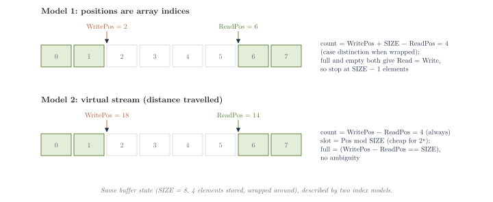

*Figure 22.* The same ring-buffer state described by array indices (model 1) and by a virtual stream (model 2). Own diagram after [[20](#ref-giesen-ring)].

**Relevance to the thesis** (own notes)

- Swizzling explains why the CPU should not read or write GPU-side textures directly: the layout is hardware-specific, and CPU-visible GPU memory is often write-combined, so reads are very slow and only sequential full-line writes are fast. For topic 2, results to read back should be copied by the GPU into a linear buffer in CPU-readable memory first.
- Morton order is also useful for the physics in topic 2: sorting particles by the Morton code of their grid cell keeps neighbours close in memory for the neighbour search (cf. [[13](#ref-green)]).
- The asynchronous readback in topic 2 is itself a ring buffer: N readback buffers, the GPU writes frame `f` into slot `f mod N`, the CPU reads slot `f − k` after a fence. Frame counters are a virtual stream, which gives the readback latency directly as `WriteFrame − ReadFrame`.
- The same producer/consumer view describes CPU and GPU in general: either side waiting (full or empty queue) is a stall; the goal is the steady state.

##### Part 2: GPU Memory Architecture and the Command Processor

Source: <https://fgiesen.wordpress.com/2011/07/02/a-trip-through-the-graphics-pipeline-2011-part-2/>

**The memory subsystem**

- GPU memory is *fast*: a GeForce GTX 480 has about 180 GB/s of bandwidth, a Core i7 2600K about 19 GB/s, "nearly an order of magnitude" [[3](#ref-giesen), Part 2].
- GPU memory is also *slow*: a GTX 480 memory access takes 400–800 clocks at a 1.4 GHz shader clock, a Nehalem cache miss about 140 cycles at 2.93 GHz, again nearly an order of magnitude in time [[3](#ref-giesen), Part 2].
- The general pattern: "GPUs are all about throughput over latency; don't wait for results that aren't there yet, do something else instead!" [[3](#ref-giesen), Part 2].
- DRAM is a 2D grid of rows and columns, and an access always reads a whole row, so accessing memory within one DRAM row is much cheaper than the same amount spread over several rows. Peak bandwidth is reachable only by reading full rows, not a few bytes all over memory ("this will be on the exam") [[3](#ref-giesen), Part 2].
- Modern GPUs have several memory controllers, each with several memory banks, behind a wide hub [[3](#ref-giesen), Part 2].

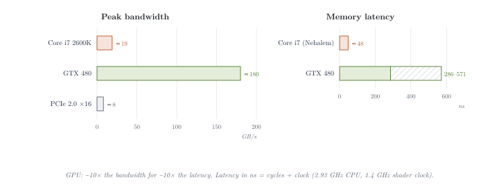

*Figure 23.* Peak bandwidth and memory latency of a 2011 CPU, GPU and PCIe link, using Giesen’s numbers. Own diagram after [[3](#ref-giesen), Part 2].

**The PCIe host interface**

- Gives the CPU access to video memory and GPU registers, and the GPU access to (part of) main memory. Latency is even worse than memory latency, since signals leave the chip and cross the mainboard; bandwidth is decent: about 8 GB/s theoretical peak for PCIe 2.0 ×16, a half to a third of the CPU's memory bandwidth, symmetric in both directions (unlike AGP) [[3](#ref-giesen), Part 2].

**Video memory, system memory and the MMU**

- Two kinds of memory: local video memory and mapped system memory (over PCIe). The simplest selection is an extra address bit; consoles with unified memory have only one [[3](#ref-giesen), Part 2].
- An *MMU* gives a virtual address space: parts of a texture can live in video memory, parts in system memory, parts not mapped at all; video memory can be defragmented without copying, and several processes can share the GPU more easily [[3](#ref-giesen), Part 2].
- A *DMA engine* copies memory without involving the 3D hardware or shader cores: system ↔ video memory and often video ↔ video, usually not system ↔ system ("do your system memory copies on the CPU") [[3](#ref-giesen), Part 2].

**The command processor**

- "Buffering…": both memory paths have high bandwidth and high latency, but there is only one command processor that must process the command buffer in order (state changes and draws must stay in sequence), so it cannot hide latency with many threads. Instead it has a large buffer and prefetches far ahead [[3](#ref-giesen), Part 2].
- The front end is a state machine that parses commands in a hardware-specific format. Commands either do 2D operations (dedicated 2D hardware, even a VGA unit, still exists on the die), hand primitives to the 3D/shader pipeline, send work to it that renders nothing (later parts), change state, or synchronise [[3](#ref-giesen), Part 2].

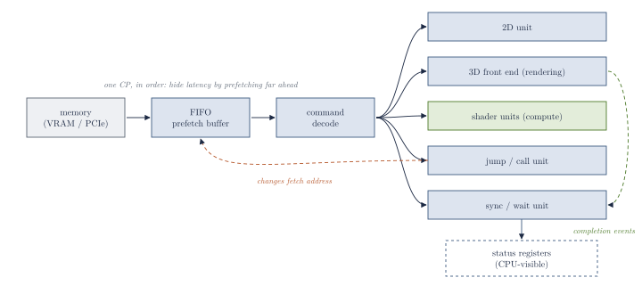

*Figure 24.* The command processor: a prefetching FIFO, command decode, and units for 2D, 3D, compute, jumps/calls and synchronisation with CPU-visible status registers. Own diagram after [[3](#ref-giesen), Part 2].

**State changes in a parallel machine**

- A state change looks like setting a variable, but in a massively parallel pipeline it needs supporting hardware. GPUs use different methods for different kinds of state [[3](#ref-giesen), Part 2]:

**Table 2.** Strategies for handling state changes. Adapted from [[3](#ref-giesen), Part 2].

| Strategy | How it works | Cost / limits |
|---|---|---|
| Partial pipeline flush | all pending work that may use the old state must finish first | historically the default; expensive with many batches and long pipelines; still used for rarely changed state |
| Stateless units | state travels down the pipeline with the work | cheap for a few bits, impractical for large state (e.g. all bound textures) |
| Multiple state slots | 2 or 4 copies of the state; each command carries a slot index | the front end can run ahead by one or more state changes; waits when all slots are busy |
| Renaming | pool of physical descriptors (e.g. 128 texture descriptors), versions allocated on demand | fast while few resources are used; slow when an app really uses very many |

**Synchronisation**

- Commands of the form "if event X happens, do Y". Y is either a *push* notification (an interrupt, e.g. "entering vertical blank now"; expensive, so only for rare high-priority events) or a *pull* model: the GPU writes a value into a CPU-visible status register, and the CPU reads it later [[3](#ref-giesen), Part 2].
- Example: the KMD gives each command buffer a sequence number and puts "write it to register 0" at its start. Since the command processor works strictly in order, reading 303 means all buffers up to 302 are finished and their memory can be reclaimed [[3](#ref-giesen), Part 2].
- Possible events X: "you got here", "all texture reads of earlier batches are done" (memory can be reclaimed), "rendering to the render targets/UAVs is complete" (they can be used as textures), "everything up to here is complete". Such operations are called *fences*; Giesen recommends sequential counters as fence values [[3](#ref-giesen), Part 2].
- GPU-side synchronisation uses a *wait* command: "wait until register M contains value N" (with care for wrap-around). This handles render-target-to-texture dependencies and gives a full GPU flush: "set register 0 to ++seqId when all pending jobs are done" + "wait until register 0 == seqId". Until DX11 compute shaders this was the only GPU-side synchronisation mechanism; regular rendering needs no more [[3](#ref-giesen), Part 2].
- If the CPU can write the registers, it can unblock the GPU: submit a command buffer with a wait in front of a draw whose vertex/index buffers are still being written by another CPU thread, then write the register when they are ready (D3D11-style multithreaded rendering) [[3](#ref-giesen), Part 2].
- The set/wait register model covers both reporting resource use back to the CPU and GPU self-synchronisation [[3](#ref-giesen), Part 2].

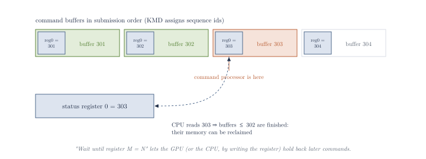

*Figure 25.* Fences: each command buffer writes its sequence id to a status register, so the CPU knows which buffers are finished. Own diagram after [[3](#ref-giesen), Part 2].

- Next step: vertex processing (Part 3). Compute shaders branch off already here (Part 13) [[3](#ref-giesen), Part 2].

**From the comments**

- For more on GPU hardware Giesen points to the graphics-hardware chapter of Real-Time Rendering [[4](#ref-rtr4)], SIGGRAPH papers on each GPU generation, and Hennessy and Patterson, "Computer Architecture: A Quantitative Approach"; he warns against marketing material and most hardware review sites [[3](#ref-giesen), Part 2].

**Relevance to the thesis** (own notes)

- Throughput over latency is the design rule for both topics: never make the CPU (or a shader) wait for a GPU result; do other work and pick it up later.
- PCIe has far higher latency and lower bandwidth than VRAM, so data crossing it per frame must be small. Topic 1: in the GPU-driven variant only a few parameters cross per frame, while object data stays in VRAM. Topic 2: read back aggregated values, not the whole particle state.
- Fences are the mechanism behind asynchronous readback (OpenGL: `glFenceSync` and `glClientWaitSync` with a zero timeout to poll; or persistent mapped buffers plus fences). A sequence-number fence per frame combined with the readback ring buffer from [[20](#ref-giesen-ring)] gives the "frame N result available at frame N+k" scheme.
- The wait command shows why render-to-texture and compute → draw dependencies cost time: they are partial flushes. In OpenGL, `glMemoryBarrier` between the culling compute shader and the indirect draw is such a dependency; measure its cost.
- State changes can cause partial flushes (Table 2), which explains the Render Hell rule "sort by state" in hardware terms and why a GPU-driven renderer keeps state changes to a minimum (one shader, bindless resources).
- DRAM rows and coalesced access: the culling and physics compute shaders should access memory in contiguous chunks (structure of arrays, sorted particles).

**Open questions**

- Bandwidth and latency of my setup (GTX 1660 Ti Mobile, PCIe generation and lanes on the laptop): look up specifications and measure a readback of N bytes.
- Does OpenGL on NVIDIA implement `glClientWaitSync(…, 0)` polling without forcing a flush? Check with `GL_SYNC_FLUSH_COMMANDS_BIT`.

### 4.4 Real-Time Rendering, 4th Edition [[4](#ref-rtr4)]

---

## References

### Part I: Graphics pipeline foundations

1. Schreibt, S. (Trümpler, S.): Render Hell 2.0. Blog series, books I–V (2015). [https://simonschreibt.de/gat/renderhell/](https://simonschreibt.de/gat/renderhell/)
2. Kubisch, C.: Life of a triangle: NVIDIA's logical pipeline. NVIDIA Developer (2015). [https://developer.nvidia.com/content/life-triangle-nvidias-logical-pipeline](https://developer.nvidia.com/content/life-triangle-nvidias-logical-pipeline)
3. Giesen, F.: A trip through the Graphics Pipeline 2011. Blog series, 13 parts (2011). [https://fgiesen.wordpress.com/2011/07/09/a-trip-through-the-graphics-pipeline-2011-index/](https://fgiesen.wordpress.com/2011/07/09/a-trip-through-the-graphics-pipeline-2011-index/)
4. Akenine-Möller, T., Haines, E., Hoffman, N., Pesce, A., Iwanicki, M., Hillaire, S.: Real-Time Rendering, 4th edn. A K Peters/CRC Press, Boca Raton (2018). ISBN 978-1-138-62700-0. [https://www.realtimerendering.com/](https://www.realtimerendering.com/)

### Part II: GPU-driven rendering

5. Haar, U., Aaltonen, S.: GPU-driven rendering pipelines. SIGGRAPH 2015, Advances in Real-Time Rendering in Games. [https://advances.realtimerendering.com/s2015/](https://advances.realtimerendering.com/s2015/)
6. Everitt, C., McDonald, J., Sellers, G., Foley, T.: Approaching zero driver overhead in OpenGL. GDC 2014. [https://gdcvault.com/play/1020791](https://gdcvault.com/play/1020791)
7. Wihlidal, G.: Optimizing the graphics pipeline with compute. GDC 2016. [https://gdcvault.com/play/1023109](https://gdcvault.com/play/1023109)
8. Greene, N., Kass, M., Miller, G.: Hierarchical Z-buffer visibility. In: SIGGRAPH '93, pp. 231–238 (1993). [https://doi.org/10.1145/166117.166147](https://doi.org/10.1145/166117.166147)
9. Karis, B., Stubbe, R., Wihlidal, G.: A deep dive into Nanite virtualized geometry. SIGGRAPH 2021, Advances in Real-Time Rendering in Games. [https://advances.realtimerendering.com/s2021/](https://advances.realtimerendering.com/s2021/)
10. The Khronos Group: The OpenGL Graphics System: A Specification, Version 4.6 (Core Profile). [https://registry.khronos.org/OpenGL/](https://registry.khronos.org/OpenGL/)

### Part III: GPU physics and CUDA 

11. Müller, M., Charypar, D., Gross, M.: Particle-based fluid simulation for interactive applications. In: SCA 2003, pp. 154–159. [https://doi.org/10.2312/SCA03/154-159](https://doi.org/10.2312/SCA03/154-159)
12. Macklin, M., Müller, M.: Position based fluids. ACM Trans. Graph. 32(4) (2013). [https://doi.org/10.1145/2461912.2461984](https://doi.org/10.1145/2461912.2461984)
13. Green, S.: Particle simulation using CUDA. NVIDIA (2010). [https://developer.download.nvidia.com/](https://developer.download.nvidia.com/)
14. NVIDIA Corporation: CUDA C++ Programming Guide: Graphics Interoperability. [https://docs.nvidia.com/cuda/](https://docs.nvidia.com/cuda/)
15. Białas, P., Strzelecki, A.: Benchmarking the cost of thread divergence in CUDA. In: PPAM 2015 (2015). [https://arxiv.org/abs/1504.01650](https://arxiv.org/abs/1504.01650)

### Background textbooks

16. Gregory, J.: Game Engine Architecture, 3rd edn. CRC Press (2018). ISBN 978-1-138-03545-4
17. Kirk, D.B., Hwu, W.W.: Programming Massively Parallel Processors, 3rd edn. Morgan Kaufmann (2017). ISBN 978-0-12-811986-0
18. Sanders, J., Kandrot, E.: CUDA by Example. Addison-Wesley (2010). ISBN 978-0-13-138768-3

### Supplementary (Giesen blog posts)

19. Giesen, F.: Texture tiling and swizzling. The ryg blog (2011). [https://fgiesen.wordpress.com/2011/01/17/texture-tiling-and-swizzling/](https://fgiesen.wordpress.com/2011/01/17/texture-tiling-and-swizzling/)
20. Giesen, F.: Ring buffers and queues. The ryg blog (2010). [https://fgiesen.wordpress.com/2010/12/14/ring-buffers-and-queues/](https://fgiesen.wordpress.com/2010/12/14/ring-buffers-and-queues/)

---

## Notes

*Test environment* 
- AMD Ryzen 7 4800H
- NVIDIA GeForce GTX 1660 Ti Mobile (Turing TU116, 1536 CUDA cores, 6 GB GDDR6)
- OpenGL 4.6 Core; CUDA; Nsight Systems/Graphics, RenderDoc, `GL_TIME_ELAPSED` queries
