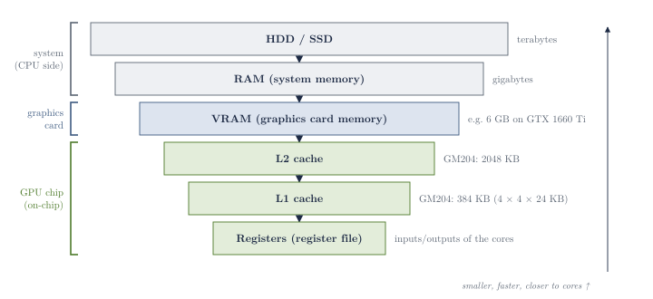
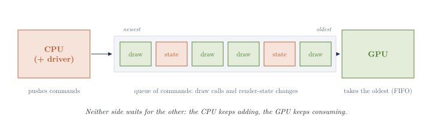
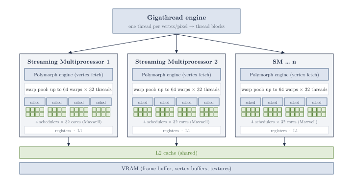
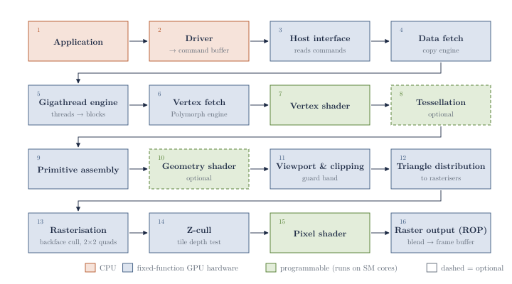
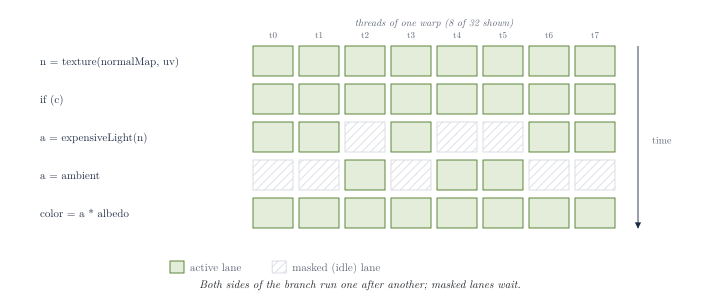
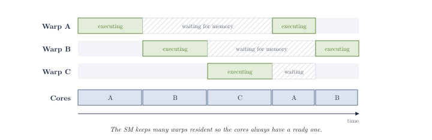
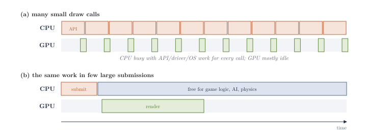
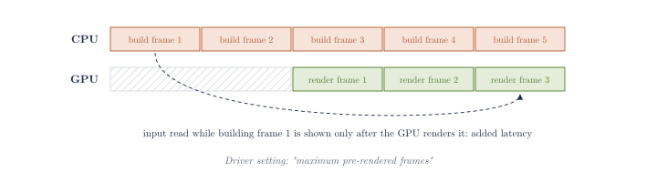
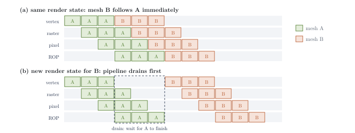
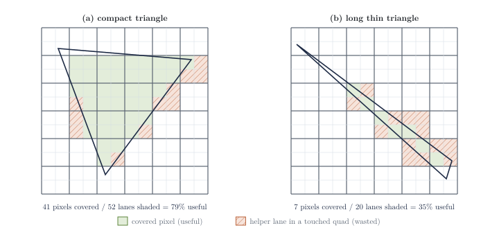

# Exploring Computer Graphics: From the Graphics Pipeline to GPU-Driven Real-Time Applications

**Kyrylo Pylinskyi**

Jagiellonian University, Kraków 

Faculty of Physics, Astronomy and Applied Computer Science 

Computer Science in Game Development

Moving tasks from the CPU to the GPU in real-time applications

Working draft (notes and citations), November 2026

> **Note on conventions.** This is a working draft consisting of notes and citations. Citations are numbered and link to the reference list. 

**Keywords:** Graphics pipeline · GPU architecture · Draw calls · Driver overhead · Batching · Instancing · Indirect drawing · GPU-driven rendering · Culling · CPU–GPU synchronisation

---

**Abstract.**

> **[To be completed]**

---

## 1. Introduction

### 1.1 Motivation

- In the classic model the CPU prepares and submits thousands of draw calls per frame, pays driver overhead for each, and competes for time with game logic, AI and physics; the GPU, despite massive parallelism, only executes what the CPU tells it to.
- Idea behind the thesis: the GPU decides what to draw, and the CPU issues a minimal number of commands.

### 1.2 Research Questions (WIP)

- **RQ1.** How does a frame travel from the application, through the driver, to pixels on screen? Which stages are fixed-function and which programmable?
- **RQ2.** How is a GPU organised (cores, warps/wavefronts, memory, caches), and how does this shape the pipeline?
- **RQ3.** Where does CPU cost arise when rendering many objects (draw calls, state changes, driver validation, synchronisation)?
- **RQ4.** Which techniques reduce that cost (batching, instancing, multi-draw indirect, GPU culling, LOD), and what are their trade-offs?
- **RQ5.** How do the CPU and GPU synchronise and exchange data, and what does a GPU→CPU readback cost?

---

## 2. Glossary

- **Draw call:** a CPU command telling the GPU to render one mesh; points to the mesh in VRAM, the material comes from the render state (see more: [Book I](#411-book-i-hardware))
- **Render state / state change:** global settings (shaders, textures, material, lighting, transparency, …) applied to every following draw call until changed (see more: [Book I](#411-book-i-hardware))
- **Command buffer:** FIFO queue of commands (draw calls, state changes); the CPU writes and the GPU reads independently, so they work asynchronously (see more: [Book I](#411-book-i-hardware))
- **Driver overhead:** CPU cost added by the graphics API, driver and OS layers to every API call (validation, command-buffer building, redundant-state removal); amortised by making as few calls as possible (see more: [Book III](#413-book-iii-problems))
- **Vertex / index buffer:** **[To be completed]**; vertex buffer = list of vertices the pipeline actually works on; kept in VRAM if used often, may stay in RAM if it changes often (see more: [Book II](#412-book-ii-pipeline))
- **Shader core:** the smallest execution unit of a GPU, as GPU vendors use the term; not comparable to a CPU core (see more: [Book I](#411-book-i-hardware))
- **Warp / wavefront:** group of 32 threads (NVIDIA) executed in lock-step by an SM, all running the same instruction on different data; branches inside a warp diverge (see more: [Book II](#412-book-ii-pipeline))
- **Rasterisation:** fixed-function step finding which pixels (2×2 quads) a triangle covers and producing fragments; several rasterisers each own part of the screen (see more: [Book II](#412-book-ii-pipeline))
- **Fragment / pixel:** a "pre-pixel" produced by the rasteriser, shaded by the pixel shader before being written by the ROPs (see more: [Book II](#412-book-ii-pipeline))
- **Z-buffer / depth test:** **[To be completed]**; Z-cull discards whole pixel tiles lying behind existing frame-buffer depth before pixel shading (see more: [Book II](#412-book-ii-pipeline))
- **Push buffer:** buffer in which the driver collects commands before handing a whole chunk to the GPU, to reduce CPU–GPU communication (see more: [Book III](#413-book-iii-problems))
- **Pipeline flush:** waiting for all in-flight work with the old render state to finish before work with the new state can start; can be triggered by state changes (see more: [Book III](#413-book-iii-problems))
- **Batching:** [To be completed] (see more: )
- **Instancing:** [To be completed] (see more: )
- **Indirect draw:** [To be completed] (see more: )
- **Culling (frustum / backface / occlusion):** [To be completed] (see more: )
- **LOD:** [To be completed] (see more: )
- **Overdraw:** shading the same pixel several times; wasteful e.g. for alpha-blended polygons with large fully transparent areas (see more: [Book III](#413-book-iii-problems))
- **Readback / sync point:** [To be completed] (see more: )

---

## 3. The Graphics Pipeline Overview

### 3.1 GPU Hardware Organisation

- *Streaming Multiprocessor (SM):* runs shaders; receives thread blocks from the Gigathread Engine, splits them into warps of 32 threads and schedules them on its cores; holds many warps to hide memory stalls [[1](#ref-renderhell), Book II].
- *Cores* only do FP/INT arithmetic; much of the pipeline (task distribution, tessellation, rasterisation, culling, depth test, ROP) is fixed-function hardware [[1](#ref-renderhell), Book II].
- *Lock-step (SIMT):* all threads of a warp execute the same instruction; divergent branches are serialised [[1](#ref-renderhell), Book II].
- Memory hierarchy: HDD → RAM → VRAM → L2 → L1 → registers; each level smaller and faster, closer to the cores [[1](#ref-renderhell), Book I]. **[To be completed]** bandwidth, shared memory.
- A typical GPU has a single graphics command processor (front end): all graphics commands are processed serially before being distributed to the parallel units [[1](#ref-renderhell), Book III].
- Logical vs physical pipeline: all shader stages run on the same SMs, and several SMs/rasterisers work in parallel on different shaders and screen regions, so the real pipeline is far more parallel and flexible than the logical one [[1](#ref-renderhell), Book II].

### 3.2 Pipeline Stages

Application → driver (command buffer) → host interface → data fetch → vertex fetch → vertex shader → (tessellation) → primitive assembly → (geometry shader) → viewport transform & clipping → rasterisation (+ backface culling) → Z-cull → pixel shader → raster output (blending, writing to the frame buffer) [[1](#ref-renderhell), Book II]; see [Book II](#412-book-ii-pipeline) for details.

---

## 4. Source Notes

### 4.1 Render Hell 2.0 (Simon Schreibt) [[1](#ref-renderhell)]

#### 4.1.1 Book I: Hardware

Source: <https://simonschreibt.de/gat/renderhell-book1/>

- From the computer's point of view, assets are just lists of vertex and texture data; turning them into an image is done mainly by the CPU and the GPU [[1](#ref-renderhell), Book I].

**Memory and data flow**

- Data is loaded from the HDD into system memory (RAM), and the meshes and textures needed are then copied into the graphics card memory (VRAM), because the GPU can access VRAM much faster [[1](#ref-renderhell), Book I].
- After upload, a texture can be dropped from RAM (reloading it from the HDD is slow); meshes usually stay in RAM because the CPU still needs them, e.g. for collision detection [[1](#ref-renderhell), Book I].
- VRAM is still too slow for the GPU, so data is copied in small portions into on-chip caches [[1](#ref-renderhell), Book I]:
  - *L2 cache:* on the GPU, faster than VRAM (NVIDIA GM204: 2048 KB);
  - *L1 cache:* smaller and closer to the cores (GM204: 384 KB = 4 × 4 × 24 KB);
  - *register file:* input and output values of the cores; results are written back to L1/L2/VRAM to free space.
- The reason for the hierarchy is access time: the latency gap between e.g. an HDD and the L1 cache is huge [[1](#ref-renderhell), Book I].

*Figure 1.* Memory hierarchy from disk to registers: each level is smaller and faster, and closer to the cores. Own diagram after [[1](#ref-renderhell), Book I].

**Render state**

- A global definition of how meshes are rendered: "vertex and pixel shader, texture, material, lighting, transparency, etc. […]" ([[1](#ref-renderhell), Book I], quoting his source [b01], p. 711).
- Every mesh drawn uses the current render state until it is changed: a stone, a chair and a sword all get the same material unless the state is changed in between [[1](#ref-renderhell), Book I].

**Draw call**

- A command from the CPU to the GPU to render one mesh. It only points to the mesh (already in VRAM) and carries no material information, which comes from the render state [[1](#ref-renderhell), Book I].

**Pipeline**

- After a draw call, the GPU combines the render state and vertex data and turns them into pixels: building triangles from vertices, lighting, texturing, etc. These steps are the pipeline stages [[1](#ref-renderhell), Book I].
- The book shows a simplified, *logical* pipeline: each triangle/pixel passes through the logical steps, but real hardware works differently; some steps (e.g. triangle and fragment creation) may be done by other parts of the graphics card than the GPU cores [[1](#ref-renderhell), Book I].

**Parallelism**

- Rendering consists of a huge number of small tasks (thousands of vertices, millions of pixels, at least ~30 fps), so they must be computed in parallel [[1](#ref-renderhell), Book I].
- A modern CPU has 4–8 cores, each doing 4–8 float operations at once (~64 floating-point units); a GPU has thousands. The counts are not directly comparable: GPU vendors call the smallest execution unit a "core", CPU vendors the high-level unit [[1](#ref-renderhell), Book I].
- The work of a pipeline stage (e.g. a batch of vertices) is split across many cores [[1](#ref-renderhell), Book I].

**Command buffer**

- The CPU does not wait for the GPU to finish. Commands go into a queue, the *command buffer*: the CPU adds commands and the GPU takes them out when it has free resources, independently of each other [[1](#ref-renderhell), Book I].
- It is FIFO: the GPU always executes the oldest command first [[1](#ref-renderhell), Book I].
- Commands include draw calls and render-state changes [[1](#ref-renderhell), Book I].

*Figure 2.* The command buffer as a FIFO queue between CPU and GPU. Own diagram after [[1](#ref-renderhell), Book I].

**Relevance to the thesis** (own notes)

- In this model, every mesh costs at least one draw call (plus possible state changes) produced by the CPU, so CPU work grows with the number of objects: this is the CPU-driven baseline.
- Because of the command buffer, the CPU and GPU work asynchronously and can each be the bottleneck: CPU and GPU time must be measured separately.
- A GPU→CPU readback (topic 2) breaks this decoupling: the CPU has to wait for a result the GPU has not produced yet.

**Open questions**

- Where does the driver sit between the API call and the command buffer, and what does it cost? Partly answered in Book II (the driver fills the command buffer and can be a bottleneck); details: Book III, Giesen Part 1 [[3](#ref-giesen)].
- What happens when a mesh has more vertices than there are cores? Answered in Book II: one thread per vertex, bundled into thread blocks and warps that the SMs schedule over time.
- The cache sizes are for GM204 (Maxwell, 2015); look up the numbers for my Turing TU116.

#### 4.1.2 Book II: Pipeline

Source: <https://simonschreibt.de/gat/renderhell-book2/>

- Written with Christoph Kubisch (NVIDIA), so mostly based on NVIDIA architecture (Fermi/Maxwell); many details are omitted or simplified [[1](#ref-renderhell), Book II]. Corrects two points of Book I: not everything is done by the GPU cores, and several pipelines can run in parallel.

**What the cores do (and don't)**

- A core receives commands and data and computes them in a floating-point (FP) or integer (INT) unit: it calculates vertices and pixels (and possibly other things, e.g. physics) [[1](#ref-renderhell), Book II].
- Distributing render tasks, tessellation, culling, preparing fragments for the pixel shader, depth testing and writing pixels to the frame buffer are done by special, non-programmable hardware blocks on the GPU, not by the cores [[1](#ref-renderhell), Book II].

**Parallel pipelines**

- A core needs a *Streaming Multiprocessor (SM)* to assign it work; an SM handles a stream of vertices/pixels belonging to one shader [[1](#ref-renderhell), Book II].
- More cores per SM → more vertices/pixels in parallel, but only of the same shader. More SMs → several shader streams at once, e.g. two pixel shaders, or a vertex and a pixel shader at the same time [[1](#ref-renderhell), Book II].
- The pipeline must be flexible because the workload cannot be predicted, e.g. tessellation can add 100,000 polygons from one frame to the next [[1](#ref-renderhell), Book II].

*Figure 3.* Work distribution: the Gigathread engine sends thread blocks to the SMs, which split them into warps. Own diagram after [[1](#ref-renderhell), Book II].

**Pipeline stages** (as presented in the book)

1. *Application:* the game tells the driver it wants something rendered [[1](#ref-renderhell), Book II].
2. *Driver:* puts the commands into the command buffer and, after a while (or when the programmer forces it), sends them to the GPU. "The Driver can be a bottle-neck" (details in Book III) [[1](#ref-renderhell), Book II].
3. *Read commands:* the *Host Interface* on the GPU reads the commands [[1](#ref-renderhell), Book II].
4. *Data fetch:* some commands contain data or copy instructions; a dedicated copy engine moves data RAM ↔ VRAM (vertex buffers, textures, shader parameters; a frame typically starts with camera matrices) [[1](#ref-renderhell), Book II].
   - Rendering works on vertex lists (vertex buffers) and single vertices/pixels, not on whole models.
   - Textures are copied only if not already in VRAM; often-used vertex buffers stay in VRAM; frequently changing vertex buffers may stay in RAM, read by the GPU directly into its caches.
   - The *Gigathread Engine* creates a thread for every vertex/pixel, bundles them into *thread blocks* and distributes them to the SMs.
5. *Vertex fetch:* the SM's *Polymorph Engine* copies the needed data into caches [[1](#ref-renderhell), Book II].
6. *Shader execution:* see below.
7. *Vertex shader:* one instance (thread) per vertex; transforms position, colour, UV, etc. [[1](#ref-renderhell), Book II].
8. *Tessellation (optional):* hull shader, tessellator, domain shader; collapsed section of the page **[To be completed]**.
9. *Primitive assembly:* vertices (from the vertex or domain shader) are gathered into triangles, lines or points; the mode is set by the application per draw call [[1](#ref-renderhell), Book II].
10. *Geometry shader (optional):* works on whole primitives; can modify vertices, create a few new ones and change the primitive type (e.g. point → two triangles). Not suited for mass amplification; used e.g. in voxelisation [[1](#ref-renderhell), Book II].
11. *Viewport transform and clipping:* normalised space is mapped to the window resolution; triangles crossing the *guard band* are clipped, because the rasteriser can only handle triangles within its area [[1](#ref-renderhell), Book II].
12. *Triangle distribution:* there are several rasterisers, each responsible for part of the screen; a triangle is sent to every rasteriser whose area its bounding box overlaps, so big triangles are shared [[1](#ref-renderhell), Book II].
13. *Rasterisation:* backface culling, then edge setup to find which 2×2 pixel *quads* the triangle covers, producing fragments. Working in 2×2 quads can make rendering inefficient (Book III) [[1](#ref-renderhell), Book II].
14. *Z-cull:* "Pixel tiles that lie entirely behind framebuffer pixels are culled from the pipeline, eliminating the need for further pixel shading work" ([[1](#ref-renderhell), Book II], quoting the NVIDIA GF100 whitepaper).
15. *Pixel shader:* one thread per fragment, distributed to the cores like vertices: "we batch up 32 pixel threads, or better say 8 times 2×2 pixel quads, which is the smallest unit we will always work with in pixel shaders" [[1](#ref-renderhell), Book II].
16. *Raster output (ROP):* ROP units move the final pixels from L2 into the frame buffer in VRAM (GF100: 48 ROPs, closely coupled with L2), and handle blending, anti-aliasing coverage and atomic operations [[1](#ref-renderhell), Book II].

*Figure 4.* The logical pipeline with CPU, fixed-function and programmable stages. Own diagram after [[1](#ref-renderhell), Book II].

**Shader execution: warps, lock-step, latency hiding**

- The SM splits a thread block into groups of 32 threads called *warps*; a Maxwell SM can hold 64 warps and has 4 warp schedulers, each with 32 cores [[1](#ref-renderhell), Book II].
- Cores never see the whole shader, only one instruction at a time; all cores of a warp execute the same instruction on different data (*lock-step*) [[1](#ref-renderhell), Book II].
- On an `if`, both sides are executed one after another, with the inactive cores masked out ("sleeping"); the same for loops. These *divergent threads* should be minimised; if all threads take the same branch, the other side is skipped [[1](#ref-renderhell), Book II].
- The SM holds many more warps than it executes because of *memory stalls*: when a warp waits for data (e.g. a texture read), it is swapped for a warp whose data is ready [[1](#ref-renderhell), Book II].
- Correction by Guohui Wang: with dual issue and instruction-level parallelism, more than 4 warps make progress at once on Maxwell; more than 30 active warps are recommended to keep the pipeline busy [[1](#ref-renderhell), Book II].

*Figure 5.* Lock-step execution: both sides of a branch are executed one after another, with inactive lanes masked. Own diagram after [[1](#ref-renderhell), Book II].

*Figure 6.* Latency hiding: the SM switches to a ready warp while another waits for memory. Own diagram after [[1](#ref-renderhell), Book II].

**Relevance to the thesis** (own notes)

- Culling exists in hardware (backface, guard-band clipping, Z-cull), but only per triangle/pixel tile, after vertex shading. Object-level culling (frustum, occlusion, LOD) has to be done before the draw call: by the CPU in the CPU-driven variant, by a compute shader in the GPU-driven one.
- Z-cull is the hardware analogue of Hi-Z occlusion culling [[8](#ref-greene)], but at pixel-tile level.
- The driver is named as a possible bottleneck (Book III): the CPU cost of a draw call is not only the API call itself.
- Warps, divergence and occupancy matter for the compute shaders in both topics (GPU culling, particle physics); cf. Białas and Strzelecki on the cost of divergence [[15](#ref-bialas)].

**Open questions**

- Tessellation stages (collapsed on the page) still to note.
- How do the NVIDIA terms map to AMD (SM ↔ CU, warp ↔ wavefront of 64) and to Turing (my GPU)?
- What does the driver do exactly when it builds the command buffer, and when does it flush it? Partly answered in Book III (push buffer, chunk-size heuristics, pre-rendered frames).

#### 4.1.3 Book III: Problems

Source: <https://simonschreibt.de/gat/renderhell-book3/>

- Analogy: copying 10,000 files of 1 KB takes much longer than copying one 9.7 MB file, because every copy has a fixed overhead (preparing the transfer, allocating memory, moving HDD heads). Rendering many meshes, i.e. executing many commands, behaves similarly [[1](#ref-renderhell), Book III].
- Worst case: many small meshes, made worse when they use different materials [[1](#ref-renderhell), Book III].

**1. Many draw calls**

- The GPU can often render small meshes faster than the CPU can send the commands. Between the application and the GPU there are the graphics API, the driver and the operating system, and they all add CPU cost [[1](#ref-renderhell), Book III].
- "If you submit few triangles with each call, you will be completely bound by the CPU and the GPU will be mostly idle" ([[1](#ref-renderhell), Book III], quoting his source [f05]).
- "There is driver overhead whenever you make an API call, and the best way to amortize this overhead is to call the API as little as possible" ([[1](#ref-renderhell), Book III], quoting his source [a02]).
- The overhead is much lower on console APIs and the new APIs (DirectX 12, Vulkan, Metal); big submissions are still better than small ones, but less critically than before [[1](#ref-renderhell), Book III].

*Figure 7.* CPU-bound rendering with many small draw calls (a) versus few large submissions (b). Own diagram after [[1](#ref-renderhell), Book III].

**2. Many commands**

- CPU and GPU must communicate about changes to the command buffer (by updating read/write pointers), which is also overhead [[1](#ref-renderhell), Book III].
- So the driver collects commands in a *push buffer* and hands them over to the GPU in chunks, not one by one [[1](#ref-renderhell), Book III].
- While the GPU works on the previous chunk, the CPU builds the next one. The driver uses heuristics for chunk size and sometimes queues more than a whole frame before sending ("maximum pre-rendered frames" in the driver settings) [[1](#ref-renderhell), Book III].
- Downside: the GPU renders frames that are "in the past" relative to the latest player input on the CPU, adding latency (bad e.g. for VR) [[1](#ref-renderhell), Book III].
- Modern/console APIs can fill several command buffers in parallel; the driver submits them one after another (serial submission queue). In DirectX 12 these are fast to submit; in DirectX 11 the driver still did extra tracking at submission, reducing the benefit of building them in parallel [[1](#ref-renderhell), Book III].

*Figure 8.* Queued frames: the CPU builds frames ahead of the GPU, which adds input latency. Own diagram after [[1](#ref-renderhell), Book III].

**3. Many meshes and materials**

- "When changing the state, there is sometimes a need to wholly or partially flush the pipeline. For this reason, changing shader programs or material parameters can be very expensive […]" ([[1](#ref-renderhell), Book III], quoting his source [b01], pp. 711–712).
- Pattern: set state → draw → set state → draw …; state changes add setup time on both CPU and GPU [[1](#ref-renderhell), Book III].
- A *flush* (not always; depends on the changed parameters and the GPU units) means that all meshes in flight with the old state must finish before meshes with the new state can start, so only a few vertices are processed between changes [[1](#ref-renderhell), Book III].
- Most state-change cost came from older APIs on the CPU side. Because of the fixed minimum setup time per draw call, one can assume that there is no difference between rendering 2 or 200 triangles [[1](#ref-renderhell), Book III].

*Figure 9.* A render-state change can force the pipeline to drain before the next mesh starts. Own diagram after [[1](#ref-renderhell), Book III].

**4. Meshes and multi-materials**

- A mesh with several materials is split into pieces, each fed separately into the command buffer: one draw call per piece [[1](#ref-renderhell), Book III].

**5. Single graphics command processor**

- Typical GPUs have a single graphics command processor (front end): even with parallel submission from the CPU, all graphics commands are processed serially there before being distributed to the parallel units [[1](#ref-renderhell), Book III].

**6. Thin triangles**

- Hardware shades 2×2 quads per triangle (on NVIDIA 8 quads = 32 threads per group); fragments of a quad outside the triangle are computed and then ignored [[1](#ref-renderhell), Book III].
- Long thin triangles waste most of the threads in each quad. That is why full-screen post-processing is drawn as one giant triangle extending past the screen, not two triangles with a diagonal [[1](#ref-renderhell), Book III].

*Figure 10.* Shading in 2×2 quads: share of useful lanes for a compact and a thin triangle (coverage computed at pixel centres). Own diagram after [[1](#ref-renderhell), Book III].

**7. Useless overdraw**

- Much performance is wasted on alpha-blended polygons with large fully transparent areas, e.g. leaf textures or a full-screen quad for a vignette that only darkens the corners. Solution in Book IV [[1](#ref-renderhell), Book III].

**8. Mobile vs PC**

- Mobile GPUs use on-chip memory as an intermediate frame buffer, so blending and anti-aliasing are cheap, but geometry is expensive [[1](#ref-renderhell), Book III].
- They render the frame in *tiles*, copying each finished tile to the frame buffer (more power-efficient); geometry overlapping several tiles is processed several times, so many vertices cost more. Works well for UI and text (blended textured quads) [[1](#ref-renderhell), Book III].
- Desktop/console GPUs are roughly the opposite [[1](#ref-renderhell), Book III].

**From the comments** (not authoritative)

- Simon: the number of draw calls alone is not a reliable indicator; bottlenecks must be measured per project [[1](#ref-renderhell), Book III].
- Reader "a lemon": draw-call overhead is mostly CPU work in the driver (guessing whether more data is coming, optimising the command buffer, removing redundant state changes). Indirect draws pack many draws (without state changes) into one buffer and can even be generated on the GPU; in his test, one draw with many instances was still 2–4× faster than many indirect draws with one instance each. Mentions NVIDIA's Vulkan device-generated commands extension (indirect draws with state changes) [[1](#ref-renderhell), Book III].

**Relevance to the thesis** (own notes)

- This is the core motivation of topic 1: in the CPU-driven variant, CPU time per frame grows with the number of draw calls and state changes, while the GPU may be idle.
- The draw-call overhead lives in the API, driver and OS layers, so with OpenGL 4.6 (an "old" API in this sense) it should be large; this supports measuring the driver's share of CPU time.
- "2 or 200 triangles cost the same" suggests that the threshold N\* depends more on the number of objects than on their triangle counts; worth testing by varying both.
- Push buffers and pre-rendered frames show that the CPU runs ahead of the GPU by up to several frames, which matters for topic 2: a readback either waits for the GPU (stall) or arrives with a latency of a few frames.
- The single command processor means that multi-draw indirect, not parallel submission, is the way to cut the command count; the reader's test suggests that instancing can beat many indirect draws, so variant (b) vs (c) and instancing should be compared.

**Open questions**

- How large is the per-draw-call CPU cost in OpenGL 4.6 on my machine, and what share of it is the driver (measure with Nsight Systems)?
- Which state changes cause a pipeline flush on current NVIDIA hardware, and which are cheap?
- Is the "2 vs 200 triangles" rule still true on Turing, and where does it stop?
- How do pre-rendered frames interact with GPU→CPU readback latency?

#### 4.1.4 Book IV: Solutions

#### 4.1.5 Book V: Shaders

### 4.2 Life of a Triangle: NVIDIA's Logical Pipeline [[2](#ref-kubisch)]

### 4.3 A Trip through the Graphics Pipeline 2011 (Fabian Giesen) [[3](#ref-giesen)]

### 4.4 Real-Time Rendering, 4th Edition [[4](#ref-rtr4)]

---

## References

### Part I: Graphics pipeline foundations

1. Schreibt, S. (Trümpler, S.): Render Hell 2.0. Blog series, books I–V (2015). [https://simonschreibt.de/gat/renderhell/](https://simonschreibt.de/gat/renderhell/)
2. Kubisch, C.: Life of a triangle: NVIDIA's logical pipeline. NVIDIA Developer (2015). [https://developer.nvidia.com/content/life-triangle-nvidias-logical-pipeline](https://developer.nvidia.com/content/life-triangle-nvidias-logical-pipeline)
3. Giesen, F.: A trip through the Graphics Pipeline 2011. Blog series, 13 parts (2011). [https://fgiesen.wordpress.com/2011/07/09/a-trip-through-the-graphics-pipeline-2011-index/](https://fgiesen.wordpress.com/2011/07/09/a-trip-through-the-graphics-pipeline-2011-index/)
4. Akenine-Möller, T., Haines, E., Hoffman, N., Pesce, A., Iwanicki, M., Hillaire, S.: Real-Time Rendering, 4th edn. A K Peters/CRC Press, Boca Raton (2018). ISBN 978-1-138-62700-0. [https://www.realtimerendering.com/](https://www.realtimerendering.com/)

### Part II: GPU-driven rendering

5. Haar, U., Aaltonen, S.: GPU-driven rendering pipelines. SIGGRAPH 2015, Advances in Real-Time Rendering in Games. [https://advances.realtimerendering.com/s2015/](https://advances.realtimerendering.com/s2015/)
6. Everitt, C., McDonald, J., Sellers, G., Foley, T.: Approaching zero driver overhead in OpenGL. GDC 2014. [https://gdcvault.com/play/1020791](https://gdcvault.com/play/1020791)
7. Wihlidal, G.: Optimizing the graphics pipeline with compute. GDC 2016. [https://gdcvault.com/play/1023109](https://gdcvault.com/play/1023109)
8. Greene, N., Kass, M., Miller, G.: Hierarchical Z-buffer visibility. In: SIGGRAPH '93, pp. 231–238 (1993). [https://doi.org/10.1145/166117.166147](https://doi.org/10.1145/166117.166147)
9. Karis, B., Stubbe, R., Wihlidal, G.: A deep dive into Nanite virtualized geometry. SIGGRAPH 2021, Advances in Real-Time Rendering in Games. [https://advances.realtimerendering.com/s2021/](https://advances.realtimerendering.com/s2021/)
10. The Khronos Group: The OpenGL Graphics System: A Specification, Version 4.6 (Core Profile). [https://registry.khronos.org/OpenGL/](https://registry.khronos.org/OpenGL/)

### Part III: GPU physics and CUDA 

11. Müller, M., Charypar, D., Gross, M.: Particle-based fluid simulation for interactive applications. In: SCA 2003, pp. 154–159. [https://doi.org/10.2312/SCA03/154-159](https://doi.org/10.2312/SCA03/154-159)
12. Macklin, M., Müller, M.: Position based fluids. ACM Trans. Graph. 32(4) (2013). [https://doi.org/10.1145/2461912.2461984](https://doi.org/10.1145/2461912.2461984)
13. Green, S.: Particle simulation using CUDA. NVIDIA (2010). [https://developer.download.nvidia.com/](https://developer.download.nvidia.com/)
14. NVIDIA Corporation: CUDA C++ Programming Guide: Graphics Interoperability. [https://docs.nvidia.com/cuda/](https://docs.nvidia.com/cuda/)
15. Białas, P., Strzelecki, A.: Benchmarking the cost of thread divergence in CUDA. In: PPAM 2015 (2015). [https://arxiv.org/abs/1504.01650](https://arxiv.org/abs/1504.01650)

### Background textbooks

16. Gregory, J.: Game Engine Architecture, 3rd edn. CRC Press (2018). ISBN 978-1-138-03545-4
17. Kirk, D.B., Hwu, W.W.: Programming Massively Parallel Processors, 3rd edn. Morgan Kaufmann (2017). ISBN 978-0-12-811986-0
18. Sanders, J., Kandrot, E.: CUDA by Example. Addison-Wesley (2010). ISBN 978-0-13-138768-3

---

## Notes

*Test environment* 
- AMD Ryzen 7 4800H
- NVIDIA GeForce GTX 1660 Ti Mobile (Turing TU116, 1536 CUDA cores, 6 GB GDDR6)
- OpenGL 4.6 Core; CUDA; Nsight Systems/Graphics, RenderDoc, `GL_TIME_ELAPSED` queries
